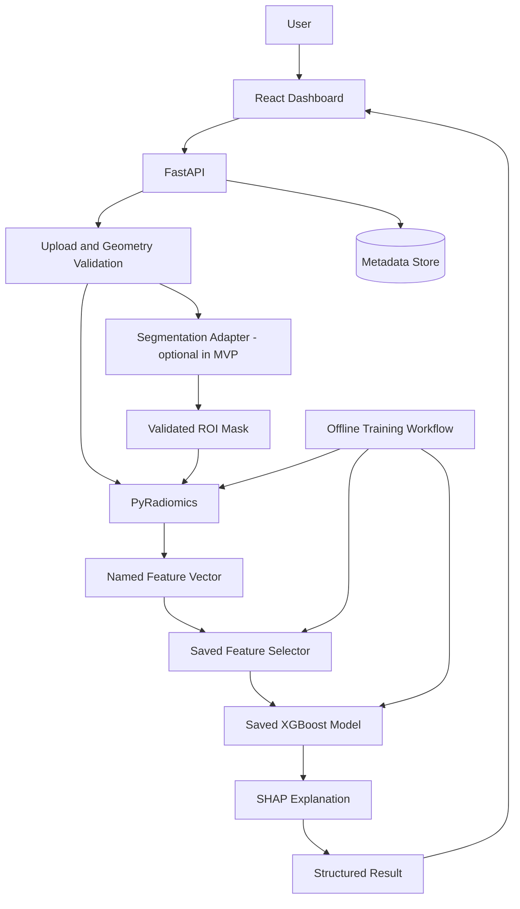
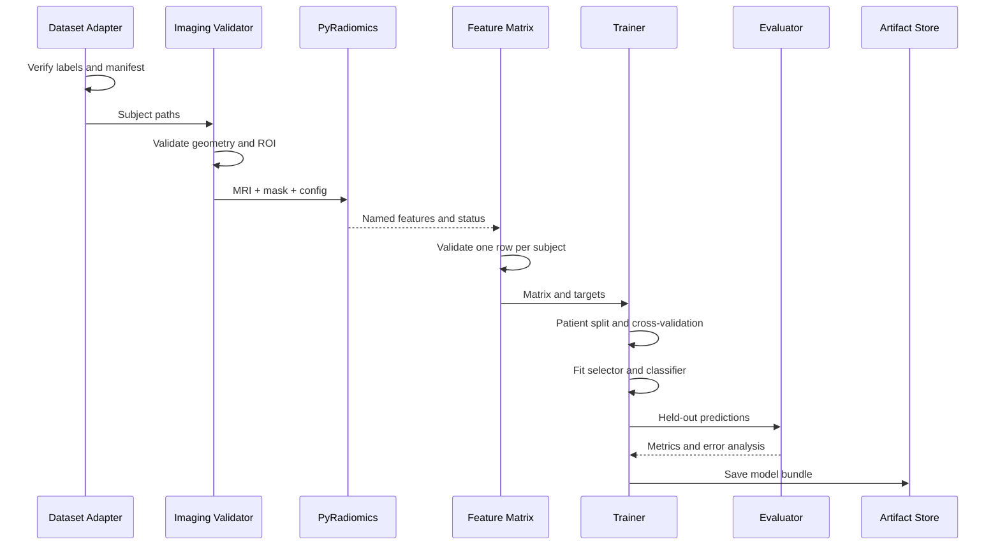
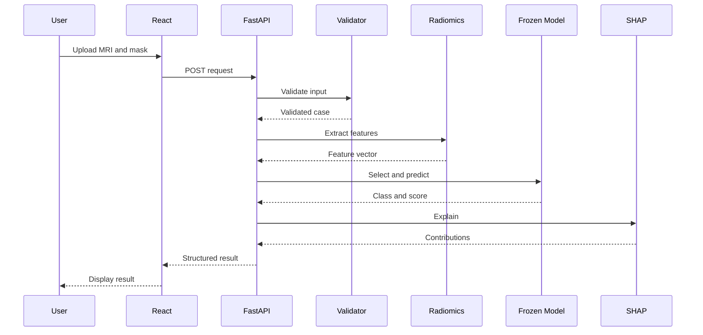

## NeuroInsight AI — System Architecture & Low-Level Design

> **Purpose:** GitHub-ready, implementation-oriented architecture for NeuroInsight AI.
>
> **Core grading pipeline:** MRI + verified mask → geometry/ROI validation → PyRadiomics → leakage-safe feature selection → XGBoost → evaluation + SHAP.
>
> **Separate product branches:** tumor-type classification (EfficientNet-B4 baseline, optional ViT), tumor segmentation (appropriate medical-imaging model), FastAPI backend, React dashboard.
>
> **Status:** design specification, not evidence of clinical validity or achieved model performance.

## Document control

| Field | Value |
|---|---|
| Project | NeuroInsight AI |
| Document | System Architecture and Low-Level Design |
| Audience | Student developer, coding agent, reviewers |
| ML language | Python |
| API | FastAPI |
| UI | React + TypeScript recommended |
| Initial grading dataset | BraTS 2017, only with verified cohort mapping |
| Initial radiomics modality | T1CE/T1Gd |
| Grading target | Historical LGG vs HGG cohort |
| Primary classifier | XGBoost |
| Explainability | SHAP |
| Intended use | Research and education; not clinical diagnosis |
| Version | 1.0 |
| Date | 2026-10-13 |

## How to use this document

1. Implement milestones in order.
2. Inspect the existing repository before changing it.
3. Keep dataset labels and label provenance explicit.
4. Validate image-mask physical geometry.
5. Use patient-level train/validation/test splits.
6. Fit data-dependent selection only within training folds.
7. Keep the final test set out of tuning.
8. Do not invent performance metrics or SHAP explanations.
9. Use expert masks for the first radiomics baseline.
10. Add automatic segmentation after the grading pipeline is reproducible.
11. Keep tumor-type classification separate from grade prediction.
12. Record design changes as Architecture Decision Records (ADRs).

## Contents

1. Scope and goals
2. Requirements
3. System context and diagrams
4. Component contracts
5. Dataset acquisition and manifest
6. Repository and storage layout
7. NIfTI geometry
8. Preprocessing and QC
9. Mask and ROI definitions
10. PyRadiomics extraction
11. Feature matrix and selection
12. Training and leakage prevention
13. XGBoost
14. Evaluation
15. SHAP
16. Tumor-type classification
17. Segmentation
18. Inference orchestration
19. FastAPI
20. React dashboard
21. Reports
22. Persistence
23. Security and privacy
24. Testing
25. Reproducibility and MLOps
26. Deployment
27. Monitoring
28. Failure handling
29. Milestones
30. Acceptance criteria
31. Interview-ready design decisions
32. Schemas, glossary and ADRs


## 1. Scope and goals

### 1.1 Primary goals
- Build a reproducible MRI-based research application.
- Predict LGG/HGG cohort from radiomic measurements.
- Explain model behavior using named features and SHAP.
- Display MRI volumes and segmentation overlays.
- Provide a typed API and a useful web interface.
- Separate data, imaging, radiomics, modeling, and presentation concerns.
- Make it possible to replace a model without rewriting the entire application.

### 1.2 Out of scope for MVP
- Clinical diagnosis or treatment advice.
- Claiming medical-device readiness.
- Survival prediction without verified outcome/follow-up labels.
- Automatic segmentation before the expert-mask grading baseline works.
- One giant end-to-end neural network combining every task.
- LLM-generated findings not grounded in computed outputs.
- Assuming one dataset's labels satisfy another task's labels.

### 1.3 Main workflows
**Workflow A — Grading**
1. Acquire MRI, expert masks, and verified cohort labels.
2. Build a manifest.
3. Validate geometry.
4. Derive WT and TC masks.
5. Extract T1CE radiomics.
6. Build a patient-level feature matrix.
7. Split patients.
8. Fit selection and XGBoost inside training folds.
9. Evaluate on an untouched test set.
10. Generate SHAP and save artifacts.

**Workflow B — Tumor type**
1. Use a dataset with explicit class labels.
2. Validate image labels and patient IDs.
3. Preprocess images consistently.
4. Fine-tune EfficientNet-B4.
5. Optionally compare ViT.
6. Evaluate class-wise metrics.
7. Expose a separate prediction endpoint.

**Workflow C — Segmentation**
1. Use expert masks in the first grading experiments.
2. Select a model compatible with MRI modalities and label regions.
3. Train or fine-tune against expert masks.
4. Evaluate on held-out subjects.
5. Integrate predicted masks only after validating geometry and labels.
6. Compare grading results from expert masks versus predicted masks.

### 1.4 Success definition
The MVP is successful when a verified sample passes through the real data pipeline, tests pass, the trained model is evaluated on held-out patients, and the dashboard shows actual outputs. High accuracy is not a software acceptance criterion; it must be measured honestly.


## 2. Requirements

### 2.1 Functional requirements
- FR-001: discover supported dataset files.
- FR-002: join verified cohort labels by subject ID.
- FR-003: detect missing modalities and masks.
- FR-004: load NIfTI volumes and spatial metadata.
- FR-005: validate MRI/mask physical geometry.
- FR-006: derive WT, TC, and ET from verified label conventions.
- FR-007: extract configured radiomic features.
- FR-008: save per-subject extraction status.
- FR-009: create a feature matrix with one row per subject/experiment.
- FR-010: split data at patient level.
- FR-011: fit feature selection inside training folds.
- FR-012: train baselines and XGBoost.
- FR-013: calculate real held-out metrics.
- FR-014: generate SHAP explanations.
- FR-015: save a versioned inference artifact.
- FR-016: validate uploads before expensive processing.
- FR-017: expose separate type and grade routes.
- FR-018: display MRI and mask overlay.
- FR-019: show model version and limitations.
- FR-020: return structured errors.
- FR-021: provide unit/integration tests.
- FR-022: record configurations and dependency versions.

### 2.2 Non-functional requirements
- Reproducibility: same artifact/configuration should give consistent outputs.
- Auditability: every prediction references a model version.
- Maintainability: one responsibility per module.
- Reliability: invalid inputs fail safely.
- Performance: heavy work must not block health checks indefinitely.
- Security: bounded uploads and controlled temporary storage.
- Privacy: raw scans are not committed to Git.
- Testability: boundaries can be tested independently.
- Accessibility: labels and legends must not rely on color alone.
- Explainability: feature attribution must use actual model outputs.

### 2.3 Priority
- P0: manifest, geometry, ROI, radiomics, selection, XGBoost, evaluation.
- P0: CLI inference and saved artifact.
- P1: FastAPI and simple React result page.
- P1: MRI viewer and overlay.
- P2: automatic segmentation and tumor-type classifier.
- P2: MLflow and containerized deployment.
- P3: multimodal ablations, robustness, calibration, external validation.


## 3. System context and architecture

### 3.1 Components
- Dataset adapter: layout and label provenance.
- Imaging: NIfTI loading and spatial geometry.
- Preprocessing: explicitly configured transformations.
- Segmentation: expert or predicted mask provider.
- Radiomics: quantitative feature extraction.
- Feature engineering: matrix creation and filtering.
- Training: splits, cross-validation, tuning, fitting.
- Evaluation: metrics and error analysis.
- Explainability: SHAP values and summaries.
- Inference: frozen pipeline execution.
- API: HTTP validation and orchestration.
- Frontend: upload, viewer, predictions, explanations.
- Tracking: experiment parameters and artifacts.
- Reports: summaries from actual computed outputs.

### 3.2 System diagram



### 3.3 Core principle
Training is offline; inference uses frozen artifacts. Training may fit selectors and tune parameters. Inference must not refit any transformation or use new case labels.

### 3.4 MVP topology
- One Python environment for ML.
- One FastAPI application.
- One React application.
- Local artifact and temporary file storage.
- SQLite or structured metadata only if persistence is needed.
- No distributed queue until measured workload justifies it.

### 3.5 Future topology
- Static frontend.
- API service behind reverse proxy.
- Background worker for long segmentation/radiomics jobs.
- Private object storage for permitted retained files.
- PostgreSQL for metadata if needed.
- Queue/Redis only when concurrency requires it.
- MLflow or artifact registry for experiment tracking.
- Separate GPU worker if segmentation dependencies require isolation.

### 3.6 Modular monolith first
Keep code modular even if it runs in one process. Split services only when scaling, GPU isolation, dependency conflicts, or deployment needs justify it.


## 4. Component contracts

### 4.1 Dataset service
Input: dataset root, dataset profile, verified label mapping, include/exclude policy.
Output: manifest, audit report, explicit errors.
Must never infer grade from MRI appearance or mask values.

### 4.2 Imaging service
Input: image, mask, expected label convention, geometry policy.
Output: loaded volume metadata, geometry status, quality warnings.
Must preserve physical metadata and make resampling explicit.

### 4.3 Radiomics service
Input: MRI, ROI mask, YAML config, ROI label.
Output: named feature dictionary, diagnostics, config hash, runtime.
Must preserve feature names and reject empty ROIs.

### 4.4 Training service
Input: patient-level features, labels, split policy, selector/model configuration.
Output: fitted pipeline, metrics, predictions, selected names, artifact metadata.
Must prevent leakage and retain test set independence.

### 4.5 Inference service
Input: validated MRI/mask, model version, extraction config.
Output: class, score, threshold, quality flags, optional SHAP.
Must load frozen artifacts and enforce feature order.

### 4.6 API service
Input: HTTP request.
Output: documented JSON and status.
Must validate uploads, use safe paths, map exceptions to error codes, and clean temporary files.

### 4.7 Interface invariants
- MRI and mask must share compatible physical space.
- ROI convention is versioned.
- Feature schema is versioned.
- Model class mapping is explicit.
- API response schema is versioned.
- The UI never invents a fallback prediction.


## 5. Dataset acquisition and manifest

### 5.1 Dataset
Use BraTS 2017 for initial LGG/HGG work only after verifying data access and cohort mapping.
- Data: https://www.med.upenn.edu/sbia/brats2017/data.html
- Tasks and mask labels: https://www.med.upenn.edu/sbia/brats2017/tasks.html
- Registration: https://www.med.upenn.edu/sbia/brats2017/registration.html

### 5.2 Label caveat
LGG/HGG are historical cohort labels, not a complete modern WHO molecular diagnosis. Keep raw label and normalized target separate.

### 5.3 Manifest columns
- `subject_id`
- `dataset_name`
- `dataset_version`
- `label_source`
- `grade_raw`
- `grade_target`
- `t1_path`
- `t1ce_path`
- `t2_path`
- `flair_path`
- `seg_path`
- `included`
- `exclusion_reason`
- `split`
- `manifest_version`

### 5.4 Manifest generation
- Scan documented layouts.
- Match files by normalized subject ID.
- Detect conflicting labels.
- Preserve mapping provenance.
- Fail closed on ambiguous mappings.
- Report missing files and class counts.
- Use deterministic ordering.
- Never use row number as patient identity.

### 5.5 Audit report
Include discovered/included/excluded subjects, reasons, class counts, modality availability, mask values, geometry ranges, duplicates, mapping source, dataset version, and license notes.

### 5.6 Example only
```csv
subject_id,dataset_name,grade_raw,grade_target,t1ce_path,seg_path,included,exclusion_reason
Brats17_EXAMPLE_001,BraTS2017,HGG,HGG,data/raw/.../t1ce.nii.gz,data/raw/.../seg.nii.gz,true,
```
This is a placeholder, not an actual record.


## 6. Repository and storage layout

```text
neuroinsight-ai/
├── README.md
├── ARCHITECTURE.md
├── pyproject.toml
├── requirements-lock.txt
├── .env.example
├── .gitignore
├── backend/app/
│   ├── main.py
│   ├── api/
│   ├── core/
│   ├── schemas/
│   └── services/
├── backend/tests/
├── frontend/src/
│   ├── api/
│   ├── components/
│   ├── features/
│   ├── pages/
│   └── types/
├── ml/
│   ├── configs/
│   ├── dataset/
│   ├── imaging/
│   ├── preprocessing/
│   ├── segmentation/
│   ├── radiomics/
│   ├── features/
│   ├── training/
│   ├── evaluation/
│   ├── explainability/
│   ├── inference/
│   └── tests/
├── scripts/
├── docs/adr/
├── docs/experiments/
├── docs/model-card/
├── data/raw/          # ignored by Git
├── data/interim/      # ignored by Git
├── data/processed/    # ignored by Git
├── data/manifests/
├── artifacts/models/  # ignored unless intentionally publishing
├── artifacts/metrics/
└── logs/              # ignored by Git
```

### Storage rules
- Never commit raw scans.
- Use relative paths in shareable manifests when possible.
- Keep local absolute paths in local configuration.
- Store checksums for integrity.
- Use Parquet for large feature tables; CSV is acceptable for an MVP.
- Keep secrets out of source control.
- Separate model artifacts from raw data.

### Naming
- Modules: `snake_case.py`.
- Classes: `PascalCase`.
- Environment variables: `UPPER_SNAKE_CASE`.
- Features: preserve PyRadiomics names.
- Model artifacts: `grade_xgb__{experiment_id}__v{version}`.
- Feature matrix: `radiomics__{modality}__{roi}__{config_hash}.parquet`.


## 7. NIfTI handling and geometry

### 7.1 Concepts
NIfTI volumes contain voxel values plus spatial metadata. Array index `(i,j,k)` alone does not determine physical location without spacing, origin, and direction/affine.

### 7.2 Loader
- Use SimpleITK or NiBabel consistently.
- Capture dimensions, spacing, origin, direction/affine.
- Validate finite intensity values.
- Validate mask label values.
- Avoid assuming array axis order equals anatomical orientation.

### 7.3 Alignment
- Compare image and mask dimensions.
- Compare spacing, origin, and direction under configured tolerances.
- Determine whether resampling is justified.
- Use continuous interpolation for MRI intensity values.
- Use nearest-neighbor for categorical masks.
- Re-check labels and overlay after resampling.
- Log transformations.

### 7.4 Do not blindly resample
BraTS files may already be preprocessed. Verify actual files. Repeated resampling can alter texture and radiomic values.

### 7.5 Geometry result schema
- `valid`
- `image_shape`
- `mask_shape`
- `image_spacing`
- `mask_spacing`
- `origin_match`
- `direction_match`
- `resampling_applied`
- `warnings`
- `errors`

### 7.6 Failure codes
- `MRI_FILE_NOT_FOUND`
- `MASK_FILE_NOT_FOUND`
- `NIFTI_READ_ERROR`
- `EMPTY_IMAGE`
- `NONFINITE_IMAGE_VALUES`
- `GEOMETRY_MISMATCH`
- `UNSUPPORTED_MASK_LABEL`
- `EMPTY_ROI`
- `UNSUPPORTED_DIMENSION`
- `RESAMPLING_FAILED`


## 8. Preprocessing and QC

### 8.1 Principle
Preprocessing is a scientific choice. It can change texture and intensity features, so document and version every transformation.

### 8.2 Baseline
- Load T1CE.
- Validate geometry.
- Use expert mask.
- Derive WT and TC.
- Avoid unnecessary normalization.
- Use one pinned PyRadiomics configuration.
- Record diagnostics.

### 8.3 Optional transforms
- Resampling when geometry requires it.
- Bias-field correction when justified.
- Intensity normalization under a defined protocol.
- ROI cropping for speed.
- Denoising only when justified and consistent.

### 8.4 Modalities
- T1: anatomy.
- T1CE/T1Gd: post-contrast T1.
- T2: water-rich structures and tissue.
- FLAIR: suppresses CSF signal while showing many lesions/edema.
Start with T1CE, then compare T2/FLAIR through controlled experiments.

### 8.5 Audit
Store transform list, original/final geometry, ROI voxel count, physical volume, intensity range, non-finite count, warnings, runtime, and config hash.

### 8.6 Leakage
Any transform that learns cohort-level parameters must be fitted on training data only. Apply the fitted transform to validation/test data without refitting.


## 9. Mask and ROI definitions

### 9.1 BraTS-style convention
Verify the exact release:
- 0: background.
- 1: necrotic/non-enhancing tumor core.
- 2: peritumoral edema.
- 4: enhancing tumor.

### 9.2 Regions
- ET: mask equals 4.
- ED: mask equals 2.
- NCR/NET: mask equals 1.
- TC: labels 1 OR 4.
- WT: labels 1 OR 2 OR 4.

Keep original multiclass mask and derived masks separately.

### 9.3 Why WT versus TC?
WT includes edema; TC focuses on tumor core. They encode different regions, so evaluate separately.

### 9.4 Validation
- ROI contains voxels.
- ROI lies within the image.
- Labels are expected.
- Geometry is valid.
- Same ROI rule is used at training and inference.
- Empty ET must not invalidate WT if WT is present.
- Empty requested ROI returns a typed error.

### 9.5 Expert versus predicted masks
Expert masks establish the radiomics baseline. A new raw-MRI case needs a provided mask or a validated segmentation model. Report expert-mask and predicted-mask results separately.

### 9.6 Mask metadata
Store mask source, segmentation model version, ROI convention version, label remapping, and quality flags.


## 10. PyRadiomics extraction

### 10.1 Inputs/outputs
Inputs: MRI, ROI mask, label value, YAML config.
Outputs: named feature dictionary, diagnostics, config hash, runtime, status.

### 10.2 Feature classes
- Shape: volume, surface area, sphericity, elongation.
- First-order: mean, variance, entropy, skewness, kurtosis, percentiles.
- GLCM: co-occurrence relationships.
- GLRLM: runs of similar gray levels.
- GLSZM: zones of similar gray levels.
- GLDM: gray-level dependencies.
- NGTDM: neighborhood gray-tone differences.
- Optional filtered images: LoG and wavelets.

### 10.3 Configuration
Version image types, feature classes, spacing/resampling, interpolator, bin width, mask label policy, filters, and diagnostics. Pin PyRadiomics version.

### 10.4 Naming
Preserve names such as `original_shape_VoxelVolume`, `original_firstorder_Mean`, `original_firstorder_Entropy`, and `original_glcm_Contrast`.

### 10.5 Diagnostics
Diagnostic fields are audit metadata by default, not predictors.

### 10.6 Batch behavior
- Process one subject at a time initially.
- Catch errors per subject.
- Resume only compatible completed cases.
- Write results incrementally.
- Use deterministic order.
- Parallelize only after correctness is proven.
- Report successes, failures, and runtime.

### 10.7 Reproducibility
Run extraction twice on a fixed sample and compare feature names/values within documented tolerance.


## 11. Feature matrix and selection

### 11.1 Matrix
One row per subject per experiment. Keep subject IDs and targets separate from predictor columns.

### 11.2 Cleaning
- Convert values to numeric.
- Identify NaN/Inf.
- Remove all-missing columns.
- Remove constant features.
- Check duplicate columns.
- Document imputation.
- Never replace every failure with zero automatically.

### 11.3 Correlation
A threshold such as absolute Pearson correlation > 0.90 may be tested. It is not universal. Fit the filter on training data only and record removed pairs.

### 11.4 Candidate selectors
- L1-regularized logistic regression.
- RFECV.
- Model-based selection inside CV.
- No supervised selection as a baseline.

### 11.5 Fold pipeline
For each training fold:
1. Fit imputer if needed.
2. Fit variance filter.
3. Fit correlation filter.
4. Fit supervised selector.
5. Fit classifier.
6. Score on that fold's validation partition.

### 11.6 Leakage
Incorrect: select features using all subjects, then split.
Correct: split first, fit learned transformations only on training folds, and apply frozen transformations to validation/test.

### 11.7 Stability
Record selection frequency across folds. Frequency is a stability signal, not proof of biological relevance.

### 11.8 Report
Input count, count after each filter, selected names, configuration, fold selection frequencies, and validation metrics.


## 12. Training and leakage prevention

### 12.1 Split unit
Split by patient, never by slice/patch. All records derived from one subject remain in one split.

### 12.2 Split policy
A stratified 70/15/15 split is one possible starting point. For small data, hold out a test set and use CV on training data. Fix the split before comparing experiments.

### 12.3 Training sequence
1. Load feature matrix.
2. Validate unique subject IDs.
3. Verify target labels.
4. Create and save split assignment.
5. Freeze test IDs.
6. Run CV on training data.
7. Tune selection/model.
8. Select candidate using validation evidence.
9. Fit final development pipeline.
10. Evaluate once on test.
11. Save predictions, metrics, artifact.

### 12.4 Stratification and groups
Use stratification when feasible. If multiple records exist per subject, use group-aware splitting. Consider site-held-out validation if source metadata exists.

### 12.5 Imbalance
Report class counts. Start unweighted. Compare class weighting only when needed. Tune threshold on validation data. Oversampling, if tested, belongs inside training folds.

### 12.6 Test integrity
Repeated test inspection for model design makes the test set part of model selection. Document this if it occurs and seek independent external validation later.


## 13. XGBoost design

### 13.1 Why XGBoost?
It is a gradient-boosted tree algorithm for tabular numerical features. It can learn nonlinear relationships and feature interactions with regularization.

### 13.2 Baselines
Compare majority class, logistic regression, random forest, and XGBoost using the same splits.

### 13.3 Candidate parameters
- `n_estimators`
- `max_depth`
- `learning_rate`
- `min_child_weight`
- `subsample`
- `colsample_bytree`
- `reg_alpha`
- `reg_lambda`
- `gamma`
- `scale_pos_weight` if justified

### 13.4 Tuning
Use a modest search space and CV on training data. Record trials. Never choose parameters from final test score.

### 13.5 Probability
A predicted probability is not automatically calibrated. Label it as a model score unless calibration has been assessed.

### 13.6 Threshold
0.5 is a default rule, not a universal optimum. Alternative thresholds must be selected using validation data.

### 13.7 Artifact bundle
Save model, selector, imputer if used, feature names/order, class mapping, threshold, calibrator if used, radiomics YAML, dependency versions, split hash, metrics, and model card.


## 14. Evaluation and error analysis

### 14.1 Metrics
- Accuracy.
- HGG precision.
- HGG sensitivity/recall.
- LGG specificity.
- F1.
- ROC-AUC.
- Confusion matrix.
- Balanced accuracy where relevant.
- Cross-validation variability.
- Confidence intervals where feasible.

### 14.2 Confusion matrix
With HGG positive:
- TP: HGG predicted HGG.
- FN: HGG predicted LGG.
- TN: LGG predicted LGG.
- FP: LGG predicted HGG.

### 14.3 Plots
- Confusion matrix.
- ROC.
- Precision-recall.
- Model metric comparison.
- CV score distribution.
- Calibration plot when assessed.
- SHAP summary.
- Feature selection frequency.
- Optional cohort feature distributions.

### 14.4 Error records
Store subject ID, truth, prediction, score, selected features, quality status, ROI, modality, SHAP summary, and review note.

### 14.5 Reporting
Label results as CV, validation, internal test, or external test. Include class counts. Never report metrics that have not been computed.


## 15. SHAP explainability

### 15.1 Purpose
SHAP estimates feature contributions to a model output. It explains model behavior; it does not prove causation or a biological mechanism.

### 15.2 Global outputs
- Mean absolute SHAP ranking.
- Summary/beeswarm plot.
- Dependence plots for selected features.
- Contribution distributions.

### 15.3 Local outputs
- Predicted class and score.
- Selected feature values.
- Contributions pushing toward either model output.
- Feature definitions.
- Model version.

### 15.4 JSON contribution
Each item: feature name, value, SHAP value, direction, display label, and optional definition.

### 15.5 Failure handling
If SHAP fails, keep the prediction and mark explanation unavailable. Never fabricate a ranking.

### 15.6 UI language
Say “features contributing to this model output.” Avoid “this feature proves the tumor is aggressive.”


## 16. Tumor-type classification branch

### 16.1 Separate target
Predict glioma, meningioma, pituitary, or no-tumor only if the chosen dataset explicitly contains those labels. This is not the LGG/HGG grading task.

### 16.2 Dataset requirements
- Verified labels.
- Patient IDs.
- Duplicate detection.
- Clear modality and image format.
- Class counts and split protocol.

### 16.3 EfficientNet-B4
- Load compatible pretrained weights.
- Replace classification head.
- Match input size and normalization.
- Start with frozen backbone or partial fine-tuning.
- Evaluate class-wise precision/recall/F1 and confusion matrix.
- Save preprocessing with weights.

### 16.4 ViT comparison
Use a pretrained ViT only if data and compute permit. Match preprocessing. Use same patient split. Do not assume a transformer is automatically better.

### 16.5 2D versus 3D
Define how a NIfTI volume becomes an image input. If using slices, aggregate slice predictions to patient level with a validated rule. Do not mix slices from one patient across splits.

### 16.6 Artifact
Save weights, class order, input dimensions, normalization, framework versions, dataset version, split hash, metrics, and limitations.

### 16.7 API
Expose `/api/predict-type` separately from `/api/predict-grade`.


## 17. Segmentation branch

### 17.1 MVP
Use expert masks for grading baseline. Automatic segmentation is a separate milestone.

### 17.2 Candidate models
- nnU-Net.
- 3D U-Net.
- MedSAM with a defined prompt strategy.
- Another suitable BraTS-trained segmentation model.

MedSAM does not automatically guarantee prompt-free 3D brain tumor segmentation. Validate its modality and inference requirements.

### 17.3 Selection criteria
- Supports required modalities.
- Supports intended 2D/3D input.
- Produces needed regions.
- Has documented training labels.
- Fits available compute.
- Has reproducible preprocessing.
- Can be evaluated against expert masks.

### 17.4 Output contract
Mask volume, canonical class mapping, geometry, model version, modalities, duration, quality flags, optional probability maps.

### 17.5 Metrics
Dice by region, sensitivity/precision where appropriate, surface-distance metric when useful, case-level failure rate, and held-out evaluation.

### 17.6 Integration
Train/evaluate segmentation offline, save artifact, implement adapter, validate output, feed mask to radiomics, compare expert-mask and predicted-mask results, then expose provenance in API.


## 18. Inference orchestration

### 18.1 Stages
1. Receive request.
2. Generate opaque request ID.
3. Validate file size and extension.
4. Save to controlled temporary storage.
5. Load MRI/mask or call segmentation.
6. Validate geometry and ROI.
7. Extract features with frozen config.
8. Validate names and finite values.
9. Apply saved selector.
10. Apply saved model.
11. Generate optional SHAP.
12. Build response.
13. Save permitted metadata.
14. Clean temporary files.

### 18.2 Frozen contract
Training and inference must match modality, ROI, label mapping, PyRadiomics version, YAML, feature names/order, selector, model, positive class, threshold, and optional calibrator.

### 18.3 Response schema
```json
{
  "prediction_id": "opaque-id",
  "task": "glioma_grade",
  "predicted_class": "HGG",
  "class_probabilities": {"LGG": 0.22, "HGG": 0.78},
  "decision_threshold": 0.5,
  "model_version": "grade-xgb-v1",
  "input_quality": {"valid": true, "roi_nonempty": true, "geometry_valid": true},
  "explanation_status": "available",
  "limitations": ["Research prototype; not for clinical diagnosis"]
}
```
Example values only; real responses must be computed.

### 18.4 Idempotency
For async jobs, bind idempotency key to payload checksum. Same key/same payload returns same job; same key/different payload returns conflict.

### 18.5 Failures
Handle missing modality, invalid file, geometry mismatch, empty ROI, extraction failure, missing feature, segmentation failure, timeout, and unavailable artifact explicitly.


## 19. FastAPI backend

### 19.1 Suggested layout
```text
backend/app/
├── main.py
├── core/config.py
├── core/logging.py
├── core/errors.py
├── api/health.py
├── api/models.py
├── api/cases.py
├── api/grade.py
├── api/tumor_type.py
├── api/explanations.py
├── api/reports.py
├── schemas/
├── services/
└── dependencies.py
```

### 19.2 Routes
- `GET /api/health`
- `GET /api/readiness`
- `GET /api/models`
- `GET /api/models/{model_id}`
- `POST /api/cases/validate`
- `POST /api/predict-grade`
- `POST /api/predict-type`
- `GET /api/predictions/{prediction_id}`
- `GET /api/predictions/{prediction_id}/explanation`
- `GET /api/predictions/{prediction_id}/report`
- `GET /api/jobs/{job_id}` if async jobs are used.

### 19.3 Status codes
- 200 success.
- 202 async job accepted.
- 400 malformed request.
- 413 too large.
- 415 unsupported media.
- 422 invalid image/mask semantics.
- 404 unknown ID.
- 409 idempotency conflict.
- 429 rate limit.
- 500 unexpected server error.
- 503 model/worker unavailable.

### 19.4 Upload handling
- Bound file sizes.
- Validate extension and actual file readability.
- Generate server-side filenames.
- Prevent path traversal.
- Use temporary directories and cleanup.
- Limit concurrent heavy jobs.
- Never return server paths.
- Do not log raw scan bytes.

### 19.5 Observability
Log request ID, route, status, duration, error code, model version, and job ID when applicable.


## 20. React dashboard

### 20.1 Suggested structure
```text
frontend/src/
├── api/
├── components/
├── features/mri-viewer/
├── features/segmentation/
├── features/grading/
├── features/classification/
├── features/explainability/
├── features/evaluation/
├── pages/
└── types/
```

### 20.2 Screens
- Overview.
- Upload.
- Validation status.
- MRI viewer.
- Segmentation overlay.
- Grade result.
- Tumor-type result.
- SHAP explanation.
- Evaluation dashboard.
- Model information and limitations.

### 20.3 Viewer
Use a medical imaging viewer such as Niivue or another maintained option. Support slice navigation, overlay toggle, opacity, and class legend. Preserve physical coordinate alignment.

### 20.4 Prediction UI
Show task, class, score/probability, threshold, model version, input quality, mask provenance, explanation status, and research limitation.

### 20.5 State management
- Uploading.
- Validating.
- Extracting.
- Predicting.
- Explaining.
- Completed.
- Failed.
- Cancelled if supported.

Clear stale result when a new case is selected. Do not show fake metrics or fallback predictions.

### 20.6 Security
Do not store raw scans in local storage. Do not put secrets in frontend environment variables. Validate API response types and safely render user-controlled strings.


## 21. Reports and persistence

### 21.1 Report sections
- Opaque case ID.
- Task.
- Input modalities.
- Mask provenance.
- Validation status.
- Predicted class and score.
- Threshold.
- Model version.
- Selected features.
- SHAP summary.
- Warnings.
- Research-use limitation.
- Timestamp and report schema version.

### 21.2 Truthfulness
Only use validated inputs and computed results. If a field is unavailable, mark it unavailable. Do not invent symptoms, age, molecular diagnosis, treatment, or outcome.

### 21.3 Persistence tables
`model_registry`: model ID, task, version, artifact URI, config hash, created timestamp, state.
`prediction`: prediction ID, task, model ID, status, timestamp, input checksum, result JSON, error code.
`job`: job ID, status, submitted/started/completed timestamps, stage, error code.
`experiment`: experiment ID, dataset/split/config hashes, metrics, artifact URI.

### 21.4 Retention
Store only required data. Delete temporary uploads after configured retention. Avoid using raw filenames as public IDs. Keep audit metadata separate from image content.


## 22. Security and privacy

### Threats
- Malformed uploads.
- Memory exhaustion from huge volumes.
- Path traversal.
- Unauthorized scans/reports.
- Sensitive logs.
- Exposed keys.
- Raw data committed to Git.
- Dependency vulnerabilities.
- Abuse of expensive GPU inference.

### Controls
- Upload size limits.
- Safe server-generated names.
- Temporary storage outside public web root.
- Authentication and authorization for hosted use.
- HTTPS.
- Secret management.
- Concurrency and rate limits.
- Dependency updates.
- `.gitignore` and repository scans.
- Minimal safe logs.
- Automatic temporary file cleanup.

Public availability does not imply unrestricted redistribution. Follow dataset terms and citations. The system is not clinically validated and must not provide definitive diagnosis or treatment advice.


## 23. Testing strategy

### Unit tests
- Manifest label joins.
- Unknown-label rejection.
- Duplicate subject detection.
- NIfTI load failure.
- Geometry mismatch.
- ROI construction.
- Empty ROI rejection.
- Expected radiomics names.
- Feature matrix excludes IDs/targets.
- Selector feature order.
- Artifact reload.
- API schema validation.

### Integration tests
- Synthetic case through loading and validation.
- Extraction writes a feature row.
- Small controlled training run.
- Saved pipeline predicts.
- API returns valid response.
- Invalid case returns structured error.
- SHAP failure does not fabricate output.
- Frontend renders loading/success/error.

### Leakage tests
- Split IDs are disjoint.
- Selector fit IDs are training-only.
- No patient slices cross splits.
- Test IDs never enter tuning.
- Target and subject ID are not predictors.
- Diagnostics are not silently included.

### Test data
Prefer synthetic fixtures. Do not commit restricted MRI data. Use real samples only when terms permit.


## 24. Reproducibility, MLOps, deployment

### Experiment record
Store experiment ID, dataset version, manifest hash, split hash, modality, ROI, radiomics config hash, selector config, classifier parameters, seed, package versions, metrics, model URI, and code commit.

### MLflow
Add MLflow after the baseline scripts are reproducible. Track parameters, metrics, plots, and artifacts.

### Deployment
- Pin dependencies.
- Use Docker after local compatibility is proven.
- Run unit tests and frontend build in CI.
- Avoid full dataset downloads in normal CI.
- Use synthetic fixtures for pull requests.
- Run secret scanning and dependency checks.
- Verify artifact checksum and model version during release.

### Monitoring
Track API request count, failure rate, duration, extraction/segmentation time, queue wait, artifact load status, memory/disk, and input quality failures. Prediction distribution alone does not prove model drift.


## 25. Failure handling

### Dataset
Missing label → exclude and report.
Conflicting label → quarantine/stop.
Missing mask → exclude mask-dependent experiment.
Duplicate subject → resolve before split.
Unexpected layout → write a dataset adapter rather than guessing.

### Imaging
Invalid NIfTI → read error.
Geometry mismatch → reject or explicitly resample.
Empty ROI → reject.
Unknown labels → stop and require mapping.
Non-finite values → report and apply documented policy.

### Radiomics
Extraction exception → record subject and cause.
Changed feature names → stop matrix construction.
Non-finite feature → report.
Empty feature table → fail training.
Changed config → new experiment/matrix version.

### Training
One class in a fold → revise split or report infeasibility.
No selected features → reject candidate.
Suspiciously high test score → audit leakage and duplicates.
Artifact cannot reload → release fails.

### API/UI
Upload too large → 413.
Unsupported input → 415/422.
Worker unavailable → 503/job failure.
SHAP failure → prediction may remain valid with explanation unavailable.
Stale UI result → clear on new case.


## 26. Implementation milestones

### M0: Repository
Inspect repo, create layout, environment, `.gitignore`, README.
Acceptance: clean setup, tests run, raw data ignored.

### M1: Dataset
Build adapter, verify labels, generate manifest/audit.
Acceptance: unique subjects, provenance, missing files reported.

### M2: Imaging
Load NIfTI, validate geometry, build WT/TC/ET.
Acceptance: synthetic tests and visual overlay alignment.

### M3: Radiomics
Create YAML, extract T1CE WT/TC, save feature table, add restartable batch.
Acceptance: stable names, failures logged, one row per subject/experiment.

### M4: Grading
Save split, train baselines/XGBoost, perform leakage-safe selection, evaluate, SHAP.
Acceptance: no overlap, test untouched, real metrics, reload works.

### M5: CLI inference
Run saved artifact on one case.
Acceptance: no refit, clear failures, structured JSON.

### M6: API
Routes, upload validation, temp storage, structured errors.
Acceptance: OpenAPI and integration tests.

### M7: Dashboard
Upload, viewer, overlay, prediction, SHAP, error states.
Acceptance: real outputs, model version, disclaimer.

### M8: Segmentation
Train/evaluate model, adapter, compare expert and predicted masks.
Acceptance: segmentation metrics and separate end-to-end evaluation.

### M9: Research
WT/TC ablation, modality comparison, stability, calibration, external validation.
Acceptance: reproducible experiments and honest conclusions.


## 27. Acceptance criteria

### Data
- Unique IDs.
- Verified labels and source.
- Exclusions audited.
- Raw data excluded from Git.

### Imaging
- Geometry validated.
- ROI convention verified.
- Empty masks rejected.
- Resampling documented.
- Overlay alignment tested.

### Radiomics
- Versioned config.
- Stable feature names.
- Diagnostics separated.
- Failures logged.
- Repeatability tested.

### Model
- Patient-level split.
- Selection inside CV.
- Baselines included.
- Metrics from real predictions.
- Test untouched.
- Artifact reload verified.

### Explainability
- SHAP from fitted model.
- Feature names align.
- No causal claims.
- Failure is explicit.

### API/UI
- Uploads validated.
- Error codes stable.
- Model version visible.
- Temp files cleaned.
- Real output only.
- Disclaimer visible.

### Documentation
- Setup commands tested.
- Data terms documented.
- Evaluation report and model card exist.


## 28. Interview-ready design decisions

### Why PyRadiomics + XGBoost?
PyRadiomics produces explicit quantitative ROI measurements; XGBoost learns nonlinear decision boundaries over tabular features. SHAP helps inspect model behavior, but performance must be established experimentally.

### Why expert masks first?
They isolate grading behavior from segmentation error. Later compare predicted masks to quantify error propagation.

### Why not YOLO as the default?
The key output is a voxel-level 3D mask, not just a box. A medical segmentation model is a more natural baseline, although some YOLO variants support segmentation.

### Why separate grade and tumor type?
They have different targets, datasets, labels, preprocessing, and metrics.

### Why compare WT and TC?
WT includes edema while TC focuses on tumor core. Test whether each ROI helps rather than assuming.

### Why patient-level splitting?
Slices from one patient can be highly similar. Splitting them across train/test can inflate results.

### Why sensitivity and specificity?
Accuracy can hide class-specific errors, especially with imbalance.

### Why SHAP?
It attributes model output to named features; it does not establish causation.

### Why modular monolith first?
It is easier to build/test than microservices. Split services only when resource or deployment needs justify it.


## 29. Appendices: schemas, config, glossary, ADRs

### A. Example extraction configuration
Illustrative only; validate keys against the pinned PyRadiomics version.

```yaml
imageType:
  Original: {}

featureClass:
  shape: []
  firstorder: []
  glcm: []
  glrlm: []
  glszm: []
  gldm: []
  ngtdm: []

setting:
  binWidth: 25
  normalize: false
  resampledPixelSpacing: null
```

### B. Example error response
```json
{
  "error": {
    "code": "EMPTY_ROI",
    "message": "The requested ROI contains no voxels.",
    "request_id": "opaque-id",
    "details": {"roi_name": "WT"}
  }
}
```

### C. Glossary
- MRI: magnetic resonance imaging.
- NIfTI: neuroimaging volume format.
- Voxel: 3D image element.
- ROI: region of interest.
- WT: whole tumor.
- TC: tumor core.
- ET: enhancing tumor.
- ED: edema.
- Radiomics: quantitative image feature extraction.
- XGBoost: gradient-boosted tree model.
- SHAP: feature attribution framework.
- Leakage: information outside permitted training process influencing evaluation.
- Calibration: agreement between probability scores and observed frequencies.
- OOD: out-of-distribution input.
- Artifact: saved model or fitted transformation.
- Model card: documentation of intended use and limitations.

### D. ADRs
- ADR-001: use expert masks for first grading baseline to isolate radiomics.
- ADR-002: start with T1CE; test other modalities through ablation.
- ADR-003: keep tumor-type and grade tasks separate.
- ADR-004: use patient-level splits.
- ADR-005: modular monolith first.
- ADR-006: keep long-form features and derive wide matrix.
- ADR-007: diagnostics are metadata, not predictors by default.
- ADR-008: explanation failure does not invalidate an otherwise valid prediction.
- ADR-009: use a canonical internal mask convention.
- ADR-010: no database requirement for offline training.

### E. References
- BraTS 2017 data: https://www.med.upenn.edu/sbia/brats2017/data.html
- BraTS 2017 tasks: https://www.med.upenn.edu/sbia/brats2017/tasks.html
- BraTS 2017 registration: https://www.med.upenn.edu/sbia/brats2017/registration.html
- BraTS 2020 data: https://www.med.upenn.edu/cbica/brats2020/data.html
- PyRadiomics: https://pyradiomics.readthedocs.io/en/stable/
- PyRadiomics features: https://pyradiomics.readthedocs.io/en/stable/features.html
- XGBoost parameters: https://xgboost.readthedocs.io/en/stable/parameter.html
- SHAP: https://shap.readthedocs.io/
- FastAPI: https://fastapi.tiangolo.com/
- scikit-learn: https://scikit-learn.org/stable/
- MLflow: https://mlflow.org/docs/latest/
- Niivue: https://niivue.com/


## 30.1 Traceable implementation checklist — DATASET

- [ ] **DATASET-001:** Source dataset version is documented.
- [ ] **DATASET-002:** Source label provenance is retained.
- [ ] **DATASET-003:** Raw and normalized labels are separate.
- [ ] **DATASET-004:** Unknown labels are rejected.
- [ ] **DATASET-005:** Conflicting labels are rejected.
- [ ] **DATASET-006:** Subject IDs are unique after normalization.
- [ ] **DATASET-007:** Missing T1CE is reported.
- [ ] **DATASET-008:** Missing mask is reported.
- [ ] **DATASET-009:** Missing optional modalities are reported.
- [ ] **DATASET-010:** Duplicate files are investigated.
- [ ] **DATASET-011:** Manifest generation is deterministic.
- [ ] **DATASET-012:** Class counts are in the audit.
- [ ] **DATASET-013:** Dataset terms are documented.
- [ ] **DATASET-014:** Manifest checksum is recorded.
- [ ] **DATASET-015:** Raw data is ignored by Git.


## 30.2 Traceable implementation checklist — IMAGING

- [ ] **IMAGING-001:** NIfTI loader preserves spatial metadata.
- [ ] **IMAGING-002:** Dimensions are recorded.
- [ ] **IMAGING-003:** Spacing is recorded.
- [ ] **IMAGING-004:** Origin is recorded.
- [ ] **IMAGING-005:** Direction/affine is recorded.
- [ ] **IMAGING-006:** Mask labels are checked.
- [ ] **IMAGING-007:** Geometry tolerance is configured.
- [ ] **IMAGING-008:** Resampling is explicit.
- [ ] **IMAGING-009:** Image interpolation is appropriate.
- [ ] **IMAGING-010:** Mask interpolation is nearest-neighbor.
- [ ] **IMAGING-011:** ROI labels are canonicalized.
- [ ] **IMAGING-012:** Empty ROI is rejected.
- [ ] **IMAGING-013:** Non-finite voxels are detected.
- [ ] **IMAGING-014:** Geometry errors are structured.
- [ ] **IMAGING-015:** Overlay alignment is tested.


## 30.3 Traceable implementation checklist — RADIOMICS

- [ ] **RADIOMICS-001:** YAML is version controlled.
- [ ] **RADIOMICS-002:** Config hash is generated.
- [ ] **RADIOMICS-003:** PyRadiomics version is recorded.
- [ ] **RADIOMICS-004:** ROI label is passed explicitly.
- [ ] **RADIOMICS-005:** Feature names are preserved.
- [ ] **RADIOMICS-006:** Diagnostics are separate.
- [ ] **RADIOMICS-007:** Failed cases are logged.
- [ ] **RADIOMICS-008:** Batch extraction is restartable.
- [ ] **RADIOMICS-009:** Feature values are numeric.
- [ ] **RADIOMICS-010:** Non-finite features are reported.
- [ ] **RADIOMICS-011:** One row exists per subject and experiment.
- [ ] **RADIOMICS-012:** Feature order is stable.
- [ ] **RADIOMICS-013:** Repeated extraction is compared.
- [ ] **RADIOMICS-014:** Cache includes image checksum.
- [ ] **RADIOMICS-015:** Cache includes mask checksum.


## 30.4 Traceable implementation checklist — FEATURES

- [ ] **FEATURES-001:** IDs are not predictors.
- [ ] **FEATURES-002:** Targets are not predictors.
- [ ] **FEATURES-003:** Diagnostic metadata is not a predictor by default.
- [ ] **FEATURES-004:** All-missing features are removed using training data.
- [ ] **FEATURES-005:** Constant features are removed using training data.
- [ ] **FEATURES-006:** Correlation filtering is fit within training folds.
- [ ] **FEATURES-007:** Supervised selection is inside CV.
- [ ] **FEATURES-008:** Feature names are retained.
- [ ] **FEATURES-009:** Selected feature count is reported.
- [ ] **FEATURES-010:** Selector fit provenance is recorded.
- [ ] **FEATURES-011:** Selection stability is reported if measured.
- [ ] **FEATURES-012:** Missing values follow documented policy.
- [ ] **FEATURES-013:** Test set is never used for selection.
- [ ] **FEATURES-014:** Feature schema has a version.
- [ ] **FEATURES-015:** Matrix builder rejects duplicate features.


## 30.5 Traceable implementation checklist — TRAINING

- [ ] **TRAINING-001:** Patient-level split is used.
- [ ] **TRAINING-002:** Split IDs are saved.
- [ ] **TRAINING-003:** Split sets are disjoint.
- [ ] **TRAINING-004:** Random seed is recorded.
- [ ] **TRAINING-005:** Majority baseline is computed.
- [ ] **TRAINING-006:** Logistic regression baseline is computed.
- [ ] **TRAINING-007:** Random forest baseline is computed if selected.
- [ ] **TRAINING-008:** XGBoost parameters are recorded.
- [ ] **TRAINING-009:** CV folds preserve classes where possible.
- [ ] **TRAINING-010:** All preprocessing is fit within folds.
- [ ] **TRAINING-011:** Class mapping is explicit.
- [ ] **TRAINING-012:** Threshold selection uses validation data.
- [ ] **TRAINING-013:** Test set is not used for tuning.
- [ ] **TRAINING-014:** Model artifact reload is tested.
- [ ] **TRAINING-015:** Metrics include class counts.


## 30.6 Traceable implementation checklist — EVALUATION

- [ ] **EVALUATION-001:** Accuracy is computed from held-out predictions.
- [ ] **EVALUATION-002:** Precision is computed with positive class defined.
- [ ] **EVALUATION-003:** HGG sensitivity is reported.
- [ ] **EVALUATION-004:** LGG specificity is reported.
- [ ] **EVALUATION-005:** F1 is reported.
- [ ] **EVALUATION-006:** ROC-AUC is reported when valid.
- [ ] **EVALUATION-007:** Confusion matrix is saved.
- [ ] **EVALUATION-008:** CV variability is reported.
- [ ] **EVALUATION-009:** Confidence intervals are added when feasible.
- [ ] **EVALUATION-010:** Error cases are listed.
- [ ] **EVALUATION-011:** Metrics are labeled by split.
- [ ] **EVALUATION-012:** Calibration claims require calibration evaluation.
- [ ] **EVALUATION-013:** External validation is labeled separately.
- [ ] **EVALUATION-014:** No metric is fabricated.
- [ ] **EVALUATION-015:** Plots include experiment identity.


## 30.7 Traceable implementation checklist — EXPLAINABILITY

- [ ] **EXPLAINABILITY-001:** SHAP uses the saved model.
- [ ] **EXPLAINABILITY-002:** SHAP feature order matches model inputs.
- [ ] **EXPLAINABILITY-003:** Class output being explained is explicit.
- [ ] **EXPLAINABILITY-004:** Feature values accompany contributions.
- [ ] **EXPLAINABILITY-005:** Global summary is saved.
- [ ] **EXPLAINABILITY-006:** Local explanation is available when requested.
- [ ] **EXPLAINABILITY-007:** Explanation failure is represented.
- [ ] **EXPLAINABILITY-008:** Explanation failure does not invent output.
- [ ] **EXPLAINABILITY-009:** SHAP is not described as causation.
- [ ] **EXPLAINABILITY-010:** Model version accompanies explanation.


## 30.8 Traceable implementation checklist — INFERENCE

- [ ] **INFERENCE-001:** Frozen extraction config is loaded.
- [ ] **INFERENCE-002:** Frozen selector is loaded.
- [ ] **INFERENCE-003:** Frozen model is loaded.
- [ ] **INFERENCE-004:** No refitting occurs.
- [ ] **INFERENCE-005:** Feature names are checked.
- [ ] **INFERENCE-006:** Feature order is checked.
- [ ] **INFERENCE-007:** Missing required feature fails safely.
- [ ] **INFERENCE-008:** Non-finite feature handling is explicit.
- [ ] **INFERENCE-009:** Threshold is recorded.
- [ ] **INFERENCE-010:** Positive class is recorded.
- [ ] **INFERENCE-011:** Input quality flags are returned.
- [ ] **INFERENCE-012:** Mask provenance is returned.
- [ ] **INFERENCE-013:** Model version is returned.
- [ ] **INFERENCE-014:** Errors are typed.
- [ ] **INFERENCE-015:** Temporary files are cleaned.


## 30.9 Traceable implementation checklist — API

- [ ] **API-001:** Health endpoint exists.
- [ ] **API-002:** Readiness endpoint checks artifacts.
- [ ] **API-003:** Model metadata endpoint exists.
- [ ] **API-004:** Upload size is bounded.
- [ ] **API-005:** File extension is validated.
- [ ] **API-006:** Actual NIfTI read is validated.
- [ ] **API-007:** Safe filenames are generated.
- [ ] **API-008:** Path traversal is prevented.
- [ ] **API-009:** Request ID is generated.
- [ ] **API-010:** Errors have stable codes.
- [ ] **API-011:** Stack traces are not returned.
- [ ] **API-012:** Heavy jobs are bounded.
- [ ] **API-013:** OpenAPI documentation works.
- [ ] **API-014:** API tests cover invalid files.
- [ ] **API-015:** Model-unavailable behavior is tested.


## 30.10 Traceable implementation checklist — FRONTEND

- [ ] **FRONTEND-001:** Upload requirements depend on task.
- [ ] **FRONTEND-002:** Upload progress is shown when available.
- [ ] **FRONTEND-003:** Validation result is visible.
- [ ] **FRONTEND-004:** Loading stage is truthful.
- [ ] **FRONTEND-005:** Old result clears on new input.
- [ ] **FRONTEND-006:** Viewer uses a medical imaging library.
- [ ] **FRONTEND-007:** Overlay alignment is checked.
- [ ] **FRONTEND-008:** Overlay legend is available.
- [ ] **FRONTEND-009:** Mask provenance is shown.
- [ ] **FRONTEND-010:** Predicted class is shown.
- [ ] **FRONTEND-011:** Probability wording is careful.
- [ ] **FRONTEND-012:** Model version is visible.
- [ ] **FRONTEND-013:** SHAP contributions are real.
- [ ] **FRONTEND-014:** Error state is actionable.
- [ ] **FRONTEND-015:** Research disclaimer is visible.


## 30.11 Traceable implementation checklist — SECURITY

- [ ] **SECURITY-001:** Raw scans are not committed.
- [ ] **SECURITY-002:** Secrets are not committed.
- [ ] **SECURITY-003:** Frontend has no private secrets.
- [ ] **SECURITY-004:** Uploads are size-limited.
- [ ] **SECURITY-005:** Temporary storage is controlled.
- [ ] **SECURITY-006:** Authentication is considered for hosted use.
- [ ] **SECURITY-007:** HTTPS is used in hosted environments.
- [ ] **SECURITY-008:** Logs avoid raw scan content.
- [ ] **SECURITY-009:** Retention policy is documented.
- [ ] **SECURITY-010:** Dataset license is respected.
- [ ] **SECURITY-011:** Dependency checks run.
- [ ] **SECURITY-012:** Public inference has concurrency limits.
- [ ] **SECURITY-013:** Private paths are not returned.
- [ ] **SECURITY-014:** Reports avoid unnecessary sensitive details.
- [ ] **SECURITY-015:** Mock data is labeled as mock.


## 31.1 Implementation work item — Repository bootstrap

**Objective:** Create layout, environment, `.gitignore`, dependency lock, README, and smoke tests.

**Inputs**
- Versioned configuration.
- Validated upstream outputs.
- A deterministic fixture or permitted data sample.

**Implementation requirements**
- Keep responsibilities in the appropriate module.
- Add type hints and a documented public interface.
- Record stage status and duration.
- Return typed errors for expected failures.
- Keep paths and thresholds configurable.
- Add unit tests for normal and invalid input.
- Update the README or API contract when behavior changes.
- Do not invent data, predictions, metrics, or explanations.

**Acceptance**
- A documented command runs the work item.
- Tests pass.
- Output schema is asserted.
- Failure mode is exercised.
- Repeated execution is reproducible under the same inputs and configuration.


## 31.2 Implementation work item — Dataset adapter

**Objective:** Implement layout-specific file discovery and explicit label-source joins.

**Inputs**
- Versioned configuration.
- Validated upstream outputs.
- A deterministic fixture or permitted data sample.

**Implementation requirements**
- Keep responsibilities in the appropriate module.
- Add type hints and a documented public interface.
- Record stage status and duration.
- Return typed errors for expected failures.
- Keep paths and thresholds configurable.
- Add unit tests for normal and invalid input.
- Update the README or API contract when behavior changes.
- Do not invent data, predictions, metrics, or explanations.

**Acceptance**
- A documented command runs the work item.
- Tests pass.
- Output schema is asserted.
- Failure mode is exercised.
- Repeated execution is reproducible under the same inputs and configuration.


## 31.3 Implementation work item — Manifest audit

**Objective:** Report counts, missing files, conflicts, duplicates, labels, and exclusions.

**Inputs**
- Versioned configuration.
- Validated upstream outputs.
- A deterministic fixture or permitted data sample.

**Implementation requirements**
- Keep responsibilities in the appropriate module.
- Add type hints and a documented public interface.
- Record stage status and duration.
- Return typed errors for expected failures.
- Keep paths and thresholds configurable.
- Add unit tests for normal and invalid input.
- Update the README or API contract when behavior changes.
- Do not invent data, predictions, metrics, or explanations.

**Acceptance**
- A documented command runs the work item.
- Tests pass.
- Output schema is asserted.
- Failure mode is exercised.
- Repeated execution is reproducible under the same inputs and configuration.


## 31.4 Implementation work item — NIfTI loader

**Objective:** Read volumes and preserve spatial metadata through a stable abstraction.

**Inputs**
- Versioned configuration.
- Validated upstream outputs.
- A deterministic fixture or permitted data sample.

**Implementation requirements**
- Keep responsibilities in the appropriate module.
- Add type hints and a documented public interface.
- Record stage status and duration.
- Return typed errors for expected failures.
- Keep paths and thresholds configurable.
- Add unit tests for normal and invalid input.
- Update the README or API contract when behavior changes.
- Do not invent data, predictions, metrics, or explanations.

**Acceptance**
- A documented command runs the work item.
- Tests pass.
- Output schema is asserted.
- Failure mode is exercised.
- Repeated execution is reproducible under the same inputs and configuration.


## 31.5 Implementation work item — Geometry validator

**Objective:** Compare MRI/mask geometry and document resampling decisions.

**Inputs**
- Versioned configuration.
- Validated upstream outputs.
- A deterministic fixture or permitted data sample.

**Implementation requirements**
- Keep responsibilities in the appropriate module.
- Add type hints and a documented public interface.
- Record stage status and duration.
- Return typed errors for expected failures.
- Keep paths and thresholds configurable.
- Add unit tests for normal and invalid input.
- Update the README or API contract when behavior changes.
- Do not invent data, predictions, metrics, or explanations.

**Acceptance**
- A documented command runs the work item.
- Tests pass.
- Output schema is asserted.
- Failure mode is exercised.
- Repeated execution is reproducible under the same inputs and configuration.


## 31.6 Implementation work item — ROI builder

**Objective:** Construct WT/TC/ET and test label unions with synthetic masks.

**Inputs**
- Versioned configuration.
- Validated upstream outputs.
- A deterministic fixture or permitted data sample.

**Implementation requirements**
- Keep responsibilities in the appropriate module.
- Add type hints and a documented public interface.
- Record stage status and duration.
- Return typed errors for expected failures.
- Keep paths and thresholds configurable.
- Add unit tests for normal and invalid input.
- Update the README or API contract when behavior changes.
- Do not invent data, predictions, metrics, or explanations.

**Acceptance**
- A documented command runs the work item.
- Tests pass.
- Output schema is asserted.
- Failure mode is exercised.
- Repeated execution is reproducible under the same inputs and configuration.


## 31.7 Implementation work item — Radiomics config

**Objective:** Version YAML settings and compute a canonical configuration hash.

**Inputs**
- Versioned configuration.
- Validated upstream outputs.
- A deterministic fixture or permitted data sample.

**Implementation requirements**
- Keep responsibilities in the appropriate module.
- Add type hints and a documented public interface.
- Record stage status and duration.
- Return typed errors for expected failures.
- Keep paths and thresholds configurable.
- Add unit tests for normal and invalid input.
- Update the README or API contract when behavior changes.
- Do not invent data, predictions, metrics, or explanations.

**Acceptance**
- A documented command runs the work item.
- Tests pass.
- Output schema is asserted.
- Failure mode is exercised.
- Repeated execution is reproducible under the same inputs and configuration.


## 31.8 Implementation work item — Single-case extraction

**Objective:** Extract one permitted sample and inspect names, values, and diagnostics.

**Inputs**
- Versioned configuration.
- Validated upstream outputs.
- A deterministic fixture or permitted data sample.

**Implementation requirements**
- Keep responsibilities in the appropriate module.
- Add type hints and a documented public interface.
- Record stage status and duration.
- Return typed errors for expected failures.
- Keep paths and thresholds configurable.
- Add unit tests for normal and invalid input.
- Update the README or API contract when behavior changes.
- Do not invent data, predictions, metrics, or explanations.

**Acceptance**
- A documented command runs the work item.
- Tests pass.
- Output schema is asserted.
- Failure mode is exercised.
- Repeated execution is reproducible under the same inputs and configuration.


## 31.9 Implementation work item — Batch extraction

**Objective:** Add restartability, per-case status, and summary counts.

**Inputs**
- Versioned configuration.
- Validated upstream outputs.
- A deterministic fixture or permitted data sample.

**Implementation requirements**
- Keep responsibilities in the appropriate module.
- Add type hints and a documented public interface.
- Record stage status and duration.
- Return typed errors for expected failures.
- Keep paths and thresholds configurable.
- Add unit tests for normal and invalid input.
- Update the README or API contract when behavior changes.
- Do not invent data, predictions, metrics, or explanations.

**Acceptance**
- A documented command runs the work item.
- Tests pass.
- Output schema is asserted.
- Failure mode is exercised.
- Repeated execution is reproducible under the same inputs and configuration.


## 31.10 Implementation work item — Feature matrix

**Objective:** Pivot to wide form and keep target/ID out of predictors.

**Inputs**
- Versioned configuration.
- Validated upstream outputs.
- A deterministic fixture or permitted data sample.

**Implementation requirements**
- Keep responsibilities in the appropriate module.
- Add type hints and a documented public interface.
- Record stage status and duration.
- Return typed errors for expected failures.
- Keep paths and thresholds configurable.
- Add unit tests for normal and invalid input.
- Update the README or API contract when behavior changes.
- Do not invent data, predictions, metrics, or explanations.

**Acceptance**
- A documented command runs the work item.
- Tests pass.
- Output schema is asserted.
- Failure mode is exercised.
- Repeated execution is reproducible under the same inputs and configuration.


## 31.11 Implementation work item — Split manager

**Objective:** Freeze patient-level split IDs and verify no overlap.

**Inputs**
- Versioned configuration.
- Validated upstream outputs.
- A deterministic fixture or permitted data sample.

**Implementation requirements**
- Keep responsibilities in the appropriate module.
- Add type hints and a documented public interface.
- Record stage status and duration.
- Return typed errors for expected failures.
- Keep paths and thresholds configurable.
- Add unit tests for normal and invalid input.
- Update the README or API contract when behavior changes.
- Do not invent data, predictions, metrics, or explanations.

**Acceptance**
- A documented command runs the work item.
- Tests pass.
- Output schema is asserted.
- Failure mode is exercised.
- Repeated execution is reproducible under the same inputs and configuration.


## 31.12 Implementation work item — Selector pipeline

**Objective:** Fit learned feature transformations inside CV folds.

**Inputs**
- Versioned configuration.
- Validated upstream outputs.
- A deterministic fixture or permitted data sample.

**Implementation requirements**
- Keep responsibilities in the appropriate module.
- Add type hints and a documented public interface.
- Record stage status and duration.
- Return typed errors for expected failures.
- Keep paths and thresholds configurable.
- Add unit tests for normal and invalid input.
- Update the README or API contract when behavior changes.
- Do not invent data, predictions, metrics, or explanations.

**Acceptance**
- A documented command runs the work item.
- Tests pass.
- Output schema is asserted.
- Failure mode is exercised.
- Repeated execution is reproducible under the same inputs and configuration.


## 31.13 Implementation work item — Baseline models

**Objective:** Train majority, logistic regression, and optional random forest baselines.

**Inputs**
- Versioned configuration.
- Validated upstream outputs.
- A deterministic fixture or permitted data sample.

**Implementation requirements**
- Keep responsibilities in the appropriate module.
- Add type hints and a documented public interface.
- Record stage status and duration.
- Return typed errors for expected failures.
- Keep paths and thresholds configurable.
- Add unit tests for normal and invalid input.
- Update the README or API contract when behavior changes.
- Do not invent data, predictions, metrics, or explanations.

**Acceptance**
- A documented command runs the work item.
- Tests pass.
- Output schema is asserted.
- Failure mode is exercised.
- Repeated execution is reproducible under the same inputs and configuration.


## 31.14 Implementation work item — XGBoost tuning

**Objective:** Run a modest CV search and preserve all trial results.

**Inputs**
- Versioned configuration.
- Validated upstream outputs.
- A deterministic fixture or permitted data sample.

**Implementation requirements**
- Keep responsibilities in the appropriate module.
- Add type hints and a documented public interface.
- Record stage status and duration.
- Return typed errors for expected failures.
- Keep paths and thresholds configurable.
- Add unit tests for normal and invalid input.
- Update the README or API contract when behavior changes.
- Do not invent data, predictions, metrics, or explanations.

**Acceptance**
- A documented command runs the work item.
- Tests pass.
- Output schema is asserted.
- Failure mode is exercised.
- Repeated execution is reproducible under the same inputs and configuration.


## 31.15 Implementation work item — Final evaluation

**Objective:** Evaluate once on the frozen test set and save per-case predictions.

**Inputs**
- Versioned configuration.
- Validated upstream outputs.
- A deterministic fixture or permitted data sample.

**Implementation requirements**
- Keep responsibilities in the appropriate module.
- Add type hints and a documented public interface.
- Record stage status and duration.
- Return typed errors for expected failures.
- Keep paths and thresholds configurable.
- Add unit tests for normal and invalid input.
- Update the README or API contract when behavior changes.
- Do not invent data, predictions, metrics, or explanations.

**Acceptance**
- A documented command runs the work item.
- Tests pass.
- Output schema is asserted.
- Failure mode is exercised.
- Repeated execution is reproducible under the same inputs and configuration.


## 31.16 Implementation work item — SHAP

**Objective:** Generate actual global and local explanations for the selected artifact.

**Inputs**
- Versioned configuration.
- Validated upstream outputs.
- A deterministic fixture or permitted data sample.

**Implementation requirements**
- Keep responsibilities in the appropriate module.
- Add type hints and a documented public interface.
- Record stage status and duration.
- Return typed errors for expected failures.
- Keep paths and thresholds configurable.
- Add unit tests for normal and invalid input.
- Update the README or API contract when behavior changes.
- Do not invent data, predictions, metrics, or explanations.

**Acceptance**
- A documented command runs the work item.
- Tests pass.
- Output schema is asserted.
- Failure mode is exercised.
- Repeated execution is reproducible under the same inputs and configuration.


## 31.17 Implementation work item — Artifact export

**Objective:** Save model, selector, config, feature schema, versions, metrics, and model card.

**Inputs**
- Versioned configuration.
- Validated upstream outputs.
- A deterministic fixture or permitted data sample.

**Implementation requirements**
- Keep responsibilities in the appropriate module.
- Add type hints and a documented public interface.
- Record stage status and duration.
- Return typed errors for expected failures.
- Keep paths and thresholds configurable.
- Add unit tests for normal and invalid input.
- Update the README or API contract when behavior changes.
- Do not invent data, predictions, metrics, or explanations.

**Acceptance**
- A documented command runs the work item.
- Tests pass.
- Output schema is asserted.
- Failure mode is exercised.
- Repeated execution is reproducible under the same inputs and configuration.


## 31.18 Implementation work item — CLI inference

**Objective:** Run the saved pipeline on a valid MRI/mask without refitting.

**Inputs**
- Versioned configuration.
- Validated upstream outputs.
- A deterministic fixture or permitted data sample.

**Implementation requirements**
- Keep responsibilities in the appropriate module.
- Add type hints and a documented public interface.
- Record stage status and duration.
- Return typed errors for expected failures.
- Keep paths and thresholds configurable.
- Add unit tests for normal and invalid input.
- Update the README or API contract when behavior changes.
- Do not invent data, predictions, metrics, or explanations.

**Acceptance**
- A documented command runs the work item.
- Tests pass.
- Output schema is asserted.
- Failure mode is exercised.
- Repeated execution is reproducible under the same inputs and configuration.


## 31.19 Implementation work item — API health/readiness

**Objective:** Separate process liveness from model-artifact readiness.

**Inputs**
- Versioned configuration.
- Validated upstream outputs.
- A deterministic fixture or permitted data sample.

**Implementation requirements**
- Keep responsibilities in the appropriate module.
- Add type hints and a documented public interface.
- Record stage status and duration.
- Return typed errors for expected failures.
- Keep paths and thresholds configurable.
- Add unit tests for normal and invalid input.
- Update the README or API contract when behavior changes.
- Do not invent data, predictions, metrics, or explanations.

**Acceptance**
- A documented command runs the work item.
- Tests pass.
- Output schema is asserted.
- Failure mode is exercised.
- Repeated execution is reproducible under the same inputs and configuration.


## 31.20 Implementation work item — API validation

**Objective:** Add upload limits, file validation, geometry errors, and cleanup.

**Inputs**
- Versioned configuration.
- Validated upstream outputs.
- A deterministic fixture or permitted data sample.

**Implementation requirements**
- Keep responsibilities in the appropriate module.
- Add type hints and a documented public interface.
- Record stage status and duration.
- Return typed errors for expected failures.
- Keep paths and thresholds configurable.
- Add unit tests for normal and invalid input.
- Update the README or API contract when behavior changes.
- Do not invent data, predictions, metrics, or explanations.

**Acceptance**
- A documented command runs the work item.
- Tests pass.
- Output schema is asserted.
- Failure mode is exercised.
- Repeated execution is reproducible under the same inputs and configuration.


## 31.21 Implementation work item — API grade prediction

**Objective:** Call the frozen grading pipeline and return typed JSON.

**Inputs**
- Versioned configuration.
- Validated upstream outputs.
- A deterministic fixture or permitted data sample.

**Implementation requirements**
- Keep responsibilities in the appropriate module.
- Add type hints and a documented public interface.
- Record stage status and duration.
- Return typed errors for expected failures.
- Keep paths and thresholds configurable.
- Add unit tests for normal and invalid input.
- Update the README or API contract when behavior changes.
- Do not invent data, predictions, metrics, or explanations.

**Acceptance**
- A documented command runs the work item.
- Tests pass.
- Output schema is asserted.
- Failure mode is exercised.
- Repeated execution is reproducible under the same inputs and configuration.


## 31.22 Implementation work item — Frontend upload

**Objective:** Add task-aware upload controls and clear validation feedback.

**Inputs**
- Versioned configuration.
- Validated upstream outputs.
- A deterministic fixture or permitted data sample.

**Implementation requirements**
- Keep responsibilities in the appropriate module.
- Add type hints and a documented public interface.
- Record stage status and duration.
- Return typed errors for expected failures.
- Keep paths and thresholds configurable.
- Add unit tests for normal and invalid input.
- Update the README or API contract when behavior changes.
- Do not invent data, predictions, metrics, or explanations.

**Acceptance**
- A documented command runs the work item.
- Tests pass.
- Output schema is asserted.
- Failure mode is exercised.
- Repeated execution is reproducible under the same inputs and configuration.


## 31.23 Implementation work item — MRI viewer

**Objective:** Integrate a maintained medical imaging viewer.

**Inputs**
- Versioned configuration.
- Validated upstream outputs.
- A deterministic fixture or permitted data sample.

**Implementation requirements**
- Keep responsibilities in the appropriate module.
- Add type hints and a documented public interface.
- Record stage status and duration.
- Return typed errors for expected failures.
- Keep paths and thresholds configurable.
- Add unit tests for normal and invalid input.
- Update the README or API contract when behavior changes.
- Do not invent data, predictions, metrics, or explanations.

**Acceptance**
- A documented command runs the work item.
- Tests pass.
- Output schema is asserted.
- Failure mode is exercised.
- Repeated execution is reproducible under the same inputs and configuration.


## 31.24 Implementation work item — Overlay

**Objective:** Render masks only when geometry is compatible.

**Inputs**
- Versioned configuration.
- Validated upstream outputs.
- A deterministic fixture or permitted data sample.

**Implementation requirements**
- Keep responsibilities in the appropriate module.
- Add type hints and a documented public interface.
- Record stage status and duration.
- Return typed errors for expected failures.
- Keep paths and thresholds configurable.
- Add unit tests for normal and invalid input.
- Update the README or API contract when behavior changes.
- Do not invent data, predictions, metrics, or explanations.

**Acceptance**
- A documented command runs the work item.
- Tests pass.
- Output schema is asserted.
- Failure mode is exercised.
- Repeated execution is reproducible under the same inputs and configuration.


## 31.25 Implementation work item — Results UI

**Objective:** Show real predictions, model version, quality flags, and SHAP.

**Inputs**
- Versioned configuration.
- Validated upstream outputs.
- A deterministic fixture or permitted data sample.

**Implementation requirements**
- Keep responsibilities in the appropriate module.
- Add type hints and a documented public interface.
- Record stage status and duration.
- Return typed errors for expected failures.
- Keep paths and thresholds configurable.
- Add unit tests for normal and invalid input.
- Update the README or API contract when behavior changes.
- Do not invent data, predictions, metrics, or explanations.

**Acceptance**
- A documented command runs the work item.
- Tests pass.
- Output schema is asserted.
- Failure mode is exercised.
- Repeated execution is reproducible under the same inputs and configuration.


## 31.26 Implementation work item — Segmentation experiment

**Objective:** Train/evaluate a suitable model and compare masks to experts.

**Inputs**
- Versioned configuration.
- Validated upstream outputs.
- A deterministic fixture or permitted data sample.

**Implementation requirements**
- Keep responsibilities in the appropriate module.
- Add type hints and a documented public interface.
- Record stage status and duration.
- Return typed errors for expected failures.
- Keep paths and thresholds configurable.
- Add unit tests for normal and invalid input.
- Update the README or API contract when behavior changes.
- Do not invent data, predictions, metrics, or explanations.

**Acceptance**
- A documented command runs the work item.
- Tests pass.
- Output schema is asserted.
- Failure mode is exercised.
- Repeated execution is reproducible under the same inputs and configuration.


## 31.27 Implementation work item — End-to-end evaluation

**Objective:** Measure grading when masks are predicted rather than expert supplied.

**Inputs**
- Versioned configuration.
- Validated upstream outputs.
- A deterministic fixture or permitted data sample.

**Implementation requirements**
- Keep responsibilities in the appropriate module.
- Add type hints and a documented public interface.
- Record stage status and duration.
- Return typed errors for expected failures.
- Keep paths and thresholds configurable.
- Add unit tests for normal and invalid input.
- Update the README or API contract when behavior changes.
- Do not invent data, predictions, metrics, or explanations.

**Acceptance**
- A documented command runs the work item.
- Tests pass.
- Output schema is asserted.
- Failure mode is exercised.
- Repeated execution is reproducible under the same inputs and configuration.


## 31.28 Implementation work item — Tumor-type branch

**Objective:** Train separate EfficientNet classifier on appropriate labels.

**Inputs**
- Versioned configuration.
- Validated upstream outputs.
- A deterministic fixture or permitted data sample.

**Implementation requirements**
- Keep responsibilities in the appropriate module.
- Add type hints and a documented public interface.
- Record stage status and duration.
- Return typed errors for expected failures.
- Keep paths and thresholds configurable.
- Add unit tests for normal and invalid input.
- Update the README or API contract when behavior changes.
- Do not invent data, predictions, metrics, or explanations.

**Acceptance**
- A documented command runs the work item.
- Tests pass.
- Output schema is asserted.
- Failure mode is exercised.
- Repeated execution is reproducible under the same inputs and configuration.


## 31.29 Implementation work item — MLOps

**Objective:** Track config, data, split, metrics, artifacts, and code commit.

**Inputs**
- Versioned configuration.
- Validated upstream outputs.
- A deterministic fixture or permitted data sample.

**Implementation requirements**
- Keep responsibilities in the appropriate module.
- Add type hints and a documented public interface.
- Record stage status and duration.
- Return typed errors for expected failures.
- Keep paths and thresholds configurable.
- Add unit tests for normal and invalid input.
- Update the README or API contract when behavior changes.
- Do not invent data, predictions, metrics, or explanations.

**Acceptance**
- A documented command runs the work item.
- Tests pass.
- Output schema is asserted.
- Failure mode is exercised.
- Repeated execution is reproducible under the same inputs and configuration.


## 31.30 Implementation work item — Release

**Objective:** Run CI, artifact smoke test, model-card review, and security checklist.

**Inputs**
- Versioned configuration.
- Validated upstream outputs.
- A deterministic fixture or permitted data sample.

**Implementation requirements**
- Keep responsibilities in the appropriate module.
- Add type hints and a documented public interface.
- Record stage status and duration.
- Return typed errors for expected failures.
- Keep paths and thresholds configurable.
- Add unit tests for normal and invalid input.
- Update the README or API contract when behavior changes.
- Do not invent data, predictions, metrics, or explanations.

**Acceptance**
- A documented command runs the work item.
- Tests pass.
- Output schema is asserted.
- Failure mode is exercised.
- Repeated execution is reproducible under the same inputs and configuration.


## 32. Detailed sequence diagrams

### 32.1 Offline training



### 32.2 Online prediction




## 33. Risk register

| Risk | Impact | Mitigation |
|---|---|---|
| Incorrect label mapping | Invalid training target | Verify source and preserve provenance |
| Subject leakage | Inflated metrics | Patient-level split checks |
| Wrong mask convention | Incorrect ROI/features | Canonical mapping and tests |
| Geometry mismatch | Invalid feature/overlay | Physical geometry validation |
| High dimensionality | Overfitting | Fold-safe selection and baselines |
| Dataset mirror changes | Misjoined files | Dataset adapter and audit |
| Expert-mask-only evaluation | Overstated automation | Separate expert/predicted-mask metrics |
| Uncalibrated probability | Misleading confidence | Calibration assessment and careful UI |
| Unsupported input | False prediction | Fail safely |
| Dependency conflict | Runtime failure | Pinned dependencies and smoke tests |
| Raw scans in Git | Privacy/license risk | Ignore rules and repository scan |
| Fake demo output | Misleading users | Label mock mode and disable in real mode |
| LLM hallucination | Invented findings | Structured facts or deterministic templates |


## 34. Research extensions

### Experiment A: WT vs TC
Question: does including edema help relative to tumor core?
Method: identical patient split and model protocol.
Output: metric comparison and error analysis.

### Experiment B: modality ablation
Compare T1CE, T2, FLAIR, and combined features. Record feature count and performance. Avoid assuming multimodal is better.

### Experiment C: classifier ablation
Compare logistic regression, random forest, and XGBoost with the same splits.

### Experiment D: feature-selection ablation
Compare correlation + L1, RFECV, and no supervised selection.

### Experiment E: segmentation error propagation
Compare expert masks versus predicted masks and report both segmentation and grading metrics.

### Experiment F: stability
Measure feature variation under plausible mask perturbations or repeat segmentations.

### Experiment G: site generalization
If site/scanner metadata exists, consider held-out site evaluation.

### Experiment H: calibration
Compare raw and calibrated scores using validation procedures only.

For every experiment, define question, primary metric, split, config, expected outputs, and stopping condition before execution.


## 35. Operational runbooks

### 35.1 First setup
1. Create a clean virtual environment.
2. Confirm supported Python version.
3. Install pinned dependencies.
4. Run imports and tests.
5. Verify `.gitignore`.
6. Run synthetic end-to-end test.
7. Document OS-specific setup.

### 35.2 Dataset onboarding
1. Read terms and citation requirements.
2. Record source version.
3. Download through permitted source.
4. Verify archive.
5. Extract to ignored raw directory.
6. Run audit-only manifest build.
7. Inspect label counts and mask values.
8. Resolve ambiguities before training.

### 35.3 Radiomics batch
1. Run one subject.
2. Inspect feature names and values.
3. Confirm ROI.
4. Run WT and TC separately.
5. Record config hash.
6. Run small batch.
7. Inspect failures.
8. Check one row per subject/experiment.
9. Repeat extraction for stability.
10. Scale only after correctness passes.

### 35.4 Training release
1. Verify manifest and split hashes.
2. Verify labels.
3. Verify predictor columns.
4. Run baselines.
5. Run CV with fold-safe selection.
6. Review fold scores.
7. Select candidate from validation.
8. Evaluate frozen test set once.
9. Generate error analysis and SHAP.
10. Export model card and artifact.
11. Reload in clean process.

### 35.5 Prediction failure
1. Capture request ID and error code.
2. Verify file readability.
3. Verify required modalities.
4. Verify geometry.
5. Verify ROI.
6. Verify config/artifact match.
7. Verify feature names and finiteness.
8. Return structured failure.
9. Clean temporary files.
10. Add regression test.

### 35.6 Model update
1. Create new experiment ID.
2. Run full evaluation.
3. Compare on same protocol.
4. Verify feature schema.
5. Run artifact smoke tests.
6. Update model card.
7. Promote explicitly.
8. Keep prior artifact for rollback.


## 36. Coding style and pull-request policy

- Functions have one responsibility.
- Public functions use type hints and docstrings.
- Avoid giant notebook-only pipelines.
- Notebooks call reusable package functions.
- Avoid hidden global state and magic constants.
- Use structured logs and typed exceptions.
- Document assumptions next to code.
- Share preprocessing code between training and inference.
- Use dependency injection for API model artifacts.
- Mock slow segmentation in API unit tests.
- Do not commit data, credentials, or unintended artifacts.
- Add tests with every functional module.
- Run formatting, lint, tests, and frontend build in CI.
- Update architecture decisions for major design changes.


## 37. Final handoff checklist

The coding agent must return:
1. Files created/modified.
2. Architecture choices implemented.
3. Commands run.
4. Actual test results.
5. Dataset assumptions requiring human verification.
6. Model artifacts produced, if any.
7. Real metrics, if any, with split definition.
8. Known limitations and failures.
9. Next milestone.
10. Confirmation that raw data/secrets were not committed.

If the dataset is unavailable, implement the code path and synthetic tests, then state that real-data training remains pending. Do not claim the model was trained.


## 38. Traceable acceptance checklist — DATA

- [ ] **DATA-001:** Dataset source and version are documented.
- [ ] **DATA-002:** Label source is preserved for each included subject.
- [ ] **DATA-003:** Raw label and normalized target are separate.
- [ ] **DATA-004:** Ambiguous labels are rejected.
- [ ] **DATA-005:** Conflicting labels are rejected.
- [ ] **DATA-006:** Subject IDs are unique after normalization.
- [ ] **DATA-007:** Missing T1CE files are reported.
- [ ] **DATA-008:** Missing masks are reported.
- [ ] **DATA-009:** Missing optional modalities are reported.
- [ ] **DATA-010:** Duplicate files are audited.
- [ ] **DATA-011:** Manifest generation is deterministic.
- [ ] **DATA-012:** Class counts are included in the report.
- [ ] **DATA-013:** Dataset terms are documented.
- [ ] **DATA-014:** Manifest checksum is stored.
- [ ] **DATA-015:** Raw data is ignored by Git.


## 38. Traceable acceptance checklist — IMG

- [ ] **IMG-001:** Loader preserves geometry metadata.
- [ ] **IMG-002:** Dimensions are recorded.
- [ ] **IMG-003:** Spacing is recorded.
- [ ] **IMG-004:** Origin is recorded.
- [ ] **IMG-005:** Direction or affine is recorded.
- [ ] **IMG-006:** Mask labels are validated.
- [ ] **IMG-007:** Geometry tolerance is configurable.
- [ ] **IMG-008:** Resampling is explicit.
- [ ] **IMG-009:** Image interpolation is appropriate.
- [ ] **IMG-010:** Mask interpolation is nearest-neighbor.
- [ ] **IMG-011:** ROI labels are canonicalized.
- [ ] **IMG-012:** Empty ROI is rejected.
- [ ] **IMG-013:** Non-finite voxels are detected.
- [ ] **IMG-014:** Geometry errors are structured.
- [ ] **IMG-015:** Overlay alignment is tested.


## 38. Traceable acceptance checklist — RAD

- [ ] **RAD-001:** YAML config is version-controlled.
- [ ] **RAD-002:** Config hash is generated.
- [ ] **RAD-003:** PyRadiomics version is recorded.
- [ ] **RAD-004:** ROI label is explicit.
- [ ] **RAD-005:** Feature names are preserved.
- [ ] **RAD-006:** Diagnostics are separated.
- [ ] **RAD-007:** Failed cases are logged.
- [ ] **RAD-008:** Batch extraction is restartable.
- [ ] **RAD-009:** Feature values are numeric.
- [ ] **RAD-010:** Non-finite features are reported.
- [ ] **RAD-011:** One row per subject and experiment is enforced.
- [ ] **RAD-012:** Feature order is stable.
- [ ] **RAD-013:** Repeat extraction is compared.
- [ ] **RAD-014:** Cache includes image checksum.
- [ ] **RAD-015:** Cache includes mask checksum.


## 38. Traceable acceptance checklist — ML

- [ ] **ML-001:** IDs are not predictors.
- [ ] **ML-002:** Targets are not predictors.
- [ ] **ML-003:** Diagnostics are not predictors by default.
- [ ] **ML-004:** Filters fit only on training folds.
- [ ] **ML-005:** Correlation filtering is leakage-safe.
- [ ] **ML-006:** Supervised selection is inside CV.
- [ ] **ML-007:** Selected feature names are saved.
- [ ] **ML-008:** Feature selection count is reported.
- [ ] **ML-009:** Selector provenance is recorded.
- [ ] **ML-010:** Class mapping is explicit.
- [ ] **ML-011:** Patient-level split is used.
- [ ] **ML-012:** Split IDs are saved.
- [ ] **ML-013:** Split sets are disjoint.
- [ ] **ML-014:** Random seed is recorded.
- [ ] **ML-015:** Baselines are trained.
- [ ] **ML-016:** Test set is not used for tuning.
- [ ] **ML-017:** Artifact reload is tested.
- [ ] **ML-018:** Metrics include class counts.
- [ ] **ML-019:** Threshold selection uses validation.
- [ ] **ML-020:** Model card records limitations.


## 38. Traceable acceptance checklist — API

- [ ] **API-001:** Health endpoint exists.
- [ ] **API-002:** Readiness endpoint checks artifacts.
- [ ] **API-003:** Model metadata endpoint exists.
- [ ] **API-004:** Upload size is bounded.
- [ ] **API-005:** File extension is validated.
- [ ] **API-006:** NIfTI readability is checked.
- [ ] **API-007:** Safe filenames are generated.
- [ ] **API-008:** Path traversal is prevented.
- [ ] **API-009:** Request ID is generated.
- [ ] **API-010:** Error codes are stable.
- [ ] **API-011:** Stack traces are not returned.
- [ ] **API-012:** Heavy jobs are bounded.
- [ ] **API-013:** OpenAPI documentation works.
- [ ] **API-014:** Invalid uploads are tested.
- [ ] **API-015:** Model-unavailable behavior is tested.


## 38. Traceable acceptance checklist — UI

- [ ] **UI-001:** Upload requirements are task-specific.
- [ ] **UI-002:** Validation result is visible.
- [ ] **UI-003:** Loading stage is truthful.
- [ ] **UI-004:** Old result clears on new input.
- [ ] **UI-005:** Medical viewer is integrated.
- [ ] **UI-006:** Overlay alignment is checked.
- [ ] **UI-007:** Legend is available.
- [ ] **UI-008:** Mask provenance is visible.
- [ ] **UI-009:** Predicted class is displayed.
- [ ] **UI-010:** Probability wording is careful.
- [ ] **UI-011:** Model version is displayed.
- [ ] **UI-012:** SHAP contributions are real.
- [ ] **UI-013:** Unavailable values are not replaced by zero.
- [ ] **UI-014:** Errors are actionable.
- [ ] **UI-015:** Research disclaimer is visible.


## 39.1 Low-level work item — Dataset adapter

**Objective:** Discover files, normalize subject IDs, join verified labels, and emit manifest plus audit.

**Inputs**
- Versioned configuration.
- Validated upstream output.
- Deterministic fixture or permitted sample.

**Required implementation**
- Type-hinted public interface.
- Explicit return schema.
- Structured error handling.
- Logs with request or experiment ID.
- No hardcoded data paths.
- No fabricated outputs.
- Unit tests for normal and invalid input.
- Documentation update when interface changes.

**Acceptance**
- Documented command runs the component.
- Tests pass.
- Output schema is asserted.
- At least one failure mode is tested.
- Same inputs/configuration reproduce the same result within documented tolerance.


## 39.2 Low-level work item — Manifest validator

**Objective:** Check unique subjects, allowed labels, file presence, and modality completeness.

**Inputs**
- Versioned configuration.
- Validated upstream output.
- Deterministic fixture or permitted sample.

**Required implementation**
- Type-hinted public interface.
- Explicit return schema.
- Structured error handling.
- Logs with request or experiment ID.
- No hardcoded data paths.
- No fabricated outputs.
- Unit tests for normal and invalid input.
- Documentation update when interface changes.

**Acceptance**
- Documented command runs the component.
- Tests pass.
- Output schema is asserted.
- At least one failure mode is tested.
- Same inputs/configuration reproduce the same result within documented tolerance.


## 39.3 Low-level work item — NIfTI loader

**Objective:** Return volume data and preserved physical geometry through one abstraction.

**Inputs**
- Versioned configuration.
- Validated upstream output.
- Deterministic fixture or permitted sample.

**Required implementation**
- Type-hinted public interface.
- Explicit return schema.
- Structured error handling.
- Logs with request or experiment ID.
- No hardcoded data paths.
- No fabricated outputs.
- Unit tests for normal and invalid input.
- Documentation update when interface changes.

**Acceptance**
- Documented command runs the component.
- Tests pass.
- Output schema is asserted.
- At least one failure mode is tested.
- Same inputs/configuration reproduce the same result within documented tolerance.


## 39.4 Low-level work item — Geometry validator

**Objective:** Compare image/mask geometry under documented tolerance and report mismatch.

**Inputs**
- Versioned configuration.
- Validated upstream output.
- Deterministic fixture or permitted sample.

**Required implementation**
- Type-hinted public interface.
- Explicit return schema.
- Structured error handling.
- Logs with request or experiment ID.
- No hardcoded data paths.
- No fabricated outputs.
- Unit tests for normal and invalid input.
- Documentation update when interface changes.

**Acceptance**
- Documented command runs the component.
- Tests pass.
- Output schema is asserted.
- At least one failure mode is tested.
- Same inputs/configuration reproduce the same result within documented tolerance.


## 39.5 Low-level work item — ROI builder

**Objective:** Build WT/TC/ET masks from verified labels without mutating original mask.

**Inputs**
- Versioned configuration.
- Validated upstream output.
- Deterministic fixture or permitted sample.

**Required implementation**
- Type-hinted public interface.
- Explicit return schema.
- Structured error handling.
- Logs with request or experiment ID.
- No hardcoded data paths.
- No fabricated outputs.
- Unit tests for normal and invalid input.
- Documentation update when interface changes.

**Acceptance**
- Documented command runs the component.
- Tests pass.
- Output schema is asserted.
- At least one failure mode is tested.
- Same inputs/configuration reproduce the same result within documented tolerance.


## 39.6 Low-level work item — Radiomics config loader

**Objective:** Validate YAML and compute canonical hash.

**Inputs**
- Versioned configuration.
- Validated upstream output.
- Deterministic fixture or permitted sample.

**Required implementation**
- Type-hinted public interface.
- Explicit return schema.
- Structured error handling.
- Logs with request or experiment ID.
- No hardcoded data paths.
- No fabricated outputs.
- Unit tests for normal and invalid input.
- Documentation update when interface changes.

**Acceptance**
- Documented command runs the component.
- Tests pass.
- Output schema is asserted.
- At least one failure mode is tested.
- Same inputs/configuration reproduce the same result within documented tolerance.


## 39.7 Low-level work item — Single-case extractor

**Objective:** Return named feature values, diagnostics, status, and runtime.

**Inputs**
- Versioned configuration.
- Validated upstream output.
- Deterministic fixture or permitted sample.

**Required implementation**
- Type-hinted public interface.
- Explicit return schema.
- Structured error handling.
- Logs with request or experiment ID.
- No hardcoded data paths.
- No fabricated outputs.
- Unit tests for normal and invalid input.
- Documentation update when interface changes.

**Acceptance**
- Documented command runs the component.
- Tests pass.
- Output schema is asserted.
- At least one failure mode is tested.
- Same inputs/configuration reproduce the same result within documented tolerance.


## 39.8 Low-level work item — Batch extractor

**Objective:** Process manifest incrementally and resume only compatible completed cases.

**Inputs**
- Versioned configuration.
- Validated upstream output.
- Deterministic fixture or permitted sample.

**Required implementation**
- Type-hinted public interface.
- Explicit return schema.
- Structured error handling.
- Logs with request or experiment ID.
- No hardcoded data paths.
- No fabricated outputs.
- Unit tests for normal and invalid input.
- Documentation update when interface changes.

**Acceptance**
- Documented command runs the component.
- Tests pass.
- Output schema is asserted.
- At least one failure mode is tested.
- Same inputs/configuration reproduce the same result within documented tolerance.


## 39.9 Low-level work item — Feature matrix builder

**Objective:** Pivot features, join labels, reject duplicates, and keep ID/target out of X.

**Inputs**
- Versioned configuration.
- Validated upstream output.
- Deterministic fixture or permitted sample.

**Required implementation**
- Type-hinted public interface.
- Explicit return schema.
- Structured error handling.
- Logs with request or experiment ID.
- No hardcoded data paths.
- No fabricated outputs.
- Unit tests for normal and invalid input.
- Documentation update when interface changes.

**Acceptance**
- Documented command runs the component.
- Tests pass.
- Output schema is asserted.
- At least one failure mode is tested.
- Same inputs/configuration reproduce the same result within documented tolerance.


## 39.10 Low-level work item — Split manager

**Objective:** Create reproducible patient split artifact and assert disjoint groups.

**Inputs**
- Versioned configuration.
- Validated upstream output.
- Deterministic fixture or permitted sample.

**Required implementation**
- Type-hinted public interface.
- Explicit return schema.
- Structured error handling.
- Logs with request or experiment ID.
- No hardcoded data paths.
- No fabricated outputs.
- Unit tests for normal and invalid input.
- Documentation update when interface changes.

**Acceptance**
- Documented command runs the component.
- Tests pass.
- Output schema is asserted.
- At least one failure mode is tested.
- Same inputs/configuration reproduce the same result within documented tolerance.


## 39.11 Low-level work item — Feature selector

**Objective:** Expose a fitted transformer and selected names; fit only within CV.

**Inputs**
- Versioned configuration.
- Validated upstream output.
- Deterministic fixture or permitted sample.

**Required implementation**
- Type-hinted public interface.
- Explicit return schema.
- Structured error handling.
- Logs with request or experiment ID.
- No hardcoded data paths.
- No fabricated outputs.
- Unit tests for normal and invalid input.
- Documentation update when interface changes.

**Acceptance**
- Documented command runs the component.
- Tests pass.
- Output schema is asserted.
- At least one failure mode is tested.
- Same inputs/configuration reproduce the same result within documented tolerance.


## 39.12 Low-level work item — Model trainer

**Objective:** Fit baselines and XGBoost; save parameters, metrics, and artifact.

**Inputs**
- Versioned configuration.
- Validated upstream output.
- Deterministic fixture or permitted sample.

**Required implementation**
- Type-hinted public interface.
- Explicit return schema.
- Structured error handling.
- Logs with request or experiment ID.
- No hardcoded data paths.
- No fabricated outputs.
- Unit tests for normal and invalid input.
- Documentation update when interface changes.

**Acceptance**
- Documented command runs the component.
- Tests pass.
- Output schema is asserted.
- At least one failure mode is tested.
- Same inputs/configuration reproduce the same result within documented tolerance.


## 39.13 Low-level work item — Evaluator

**Objective:** Compute class metrics, plots, and per-case error records.

**Inputs**
- Versioned configuration.
- Validated upstream output.
- Deterministic fixture or permitted sample.

**Required implementation**
- Type-hinted public interface.
- Explicit return schema.
- Structured error handling.
- Logs with request or experiment ID.
- No hardcoded data paths.
- No fabricated outputs.
- Unit tests for normal and invalid input.
- Documentation update when interface changes.

**Acceptance**
- Documented command runs the component.
- Tests pass.
- Output schema is asserted.
- At least one failure mode is tested.
- Same inputs/configuration reproduce the same result within documented tolerance.


## 39.14 Low-level work item — SHAP service

**Objective:** Return actual contribution values aligned to model feature names.

**Inputs**
- Versioned configuration.
- Validated upstream output.
- Deterministic fixture or permitted sample.

**Required implementation**
- Type-hinted public interface.
- Explicit return schema.
- Structured error handling.
- Logs with request or experiment ID.
- No hardcoded data paths.
- No fabricated outputs.
- Unit tests for normal and invalid input.
- Documentation update when interface changes.

**Acceptance**
- Documented command runs the component.
- Tests pass.
- Output schema is asserted.
- At least one failure mode is tested.
- Same inputs/configuration reproduce the same result within documented tolerance.


## 39.15 Low-level work item — Inference pipeline

**Objective:** Run frozen validation, extraction, selection, prediction, and optional explanation.

**Inputs**
- Versioned configuration.
- Validated upstream output.
- Deterministic fixture or permitted sample.

**Required implementation**
- Type-hinted public interface.
- Explicit return schema.
- Structured error handling.
- Logs with request or experiment ID.
- No hardcoded data paths.
- No fabricated outputs.
- Unit tests for normal and invalid input.
- Documentation update when interface changes.

**Acceptance**
- Documented command runs the component.
- Tests pass.
- Output schema is asserted.
- At least one failure mode is tested.
- Same inputs/configuration reproduce the same result within documented tolerance.


## 39.16 Low-level work item — API app

**Objective:** Validate requests and map typed exceptions to stable responses.

**Inputs**
- Versioned configuration.
- Validated upstream output.
- Deterministic fixture or permitted sample.

**Required implementation**
- Type-hinted public interface.
- Explicit return schema.
- Structured error handling.
- Logs with request or experiment ID.
- No hardcoded data paths.
- No fabricated outputs.
- Unit tests for normal and invalid input.
- Documentation update when interface changes.

**Acceptance**
- Documented command runs the component.
- Tests pass.
- Output schema is asserted.
- At least one failure mode is tested.
- Same inputs/configuration reproduce the same result within documented tolerance.


## 39.17 Low-level work item — Upload service

**Objective:** Use safe temporary files, size limits, and cleanup.

**Inputs**
- Versioned configuration.
- Validated upstream output.
- Deterministic fixture or permitted sample.

**Required implementation**
- Type-hinted public interface.
- Explicit return schema.
- Structured error handling.
- Logs with request or experiment ID.
- No hardcoded data paths.
- No fabricated outputs.
- Unit tests for normal and invalid input.
- Documentation update when interface changes.

**Acceptance**
- Documented command runs the component.
- Tests pass.
- Output schema is asserted.
- At least one failure mode is tested.
- Same inputs/configuration reproduce the same result within documented tolerance.


## 39.18 Low-level work item — MRI viewer

**Objective:** Display slices and preserve physical coordinate alignment.

**Inputs**
- Versioned configuration.
- Validated upstream output.
- Deterministic fixture or permitted sample.

**Required implementation**
- Type-hinted public interface.
- Explicit return schema.
- Structured error handling.
- Logs with request or experiment ID.
- No hardcoded data paths.
- No fabricated outputs.
- Unit tests for normal and invalid input.
- Documentation update when interface changes.

**Acceptance**
- Documented command runs the component.
- Tests pass.
- Output schema is asserted.
- At least one failure mode is tested.
- Same inputs/configuration reproduce the same result within documented tolerance.


## 39.19 Low-level work item — Overlay component

**Objective:** Render only validated mask geometry and show region legend.

**Inputs**
- Versioned configuration.
- Validated upstream output.
- Deterministic fixture or permitted sample.

**Required implementation**
- Type-hinted public interface.
- Explicit return schema.
- Structured error handling.
- Logs with request or experiment ID.
- No hardcoded data paths.
- No fabricated outputs.
- Unit tests for normal and invalid input.
- Documentation update when interface changes.

**Acceptance**
- Documented command runs the component.
- Tests pass.
- Output schema is asserted.
- At least one failure mode is tested.
- Same inputs/configuration reproduce the same result within documented tolerance.


## 39.20 Low-level work item — Results page

**Objective:** Display actual model output, model version, quality flags, and disclaimer.

**Inputs**
- Versioned configuration.
- Validated upstream output.
- Deterministic fixture or permitted sample.

**Required implementation**
- Type-hinted public interface.
- Explicit return schema.
- Structured error handling.
- Logs with request or experiment ID.
- No hardcoded data paths.
- No fabricated outputs.
- Unit tests for normal and invalid input.
- Documentation update when interface changes.

**Acceptance**
- Documented command runs the component.
- Tests pass.
- Output schema is asserted.
- At least one failure mode is tested.
- Same inputs/configuration reproduce the same result within documented tolerance.


## 39.21 Low-level work item — Experiment tracker

**Objective:** Store data/config/split hashes, metrics, and artifact URI.

**Inputs**
- Versioned configuration.
- Validated upstream output.
- Deterministic fixture or permitted sample.

**Required implementation**
- Type-hinted public interface.
- Explicit return schema.
- Structured error handling.
- Logs with request or experiment ID.
- No hardcoded data paths.
- No fabricated outputs.
- Unit tests for normal and invalid input.
- Documentation update when interface changes.

**Acceptance**
- Documented command runs the component.
- Tests pass.
- Output schema is asserted.
- At least one failure mode is tested.
- Same inputs/configuration reproduce the same result within documented tolerance.


## 39.22 Low-level work item — CI workflow

**Objective:** Run tests, linting, frontend build, and secret checks without full dataset.

**Inputs**
- Versioned configuration.
- Validated upstream output.
- Deterministic fixture or permitted sample.

**Required implementation**
- Type-hinted public interface.
- Explicit return schema.
- Structured error handling.
- Logs with request or experiment ID.
- No hardcoded data paths.
- No fabricated outputs.
- Unit tests for normal and invalid input.
- Documentation update when interface changes.

**Acceptance**
- Documented command runs the component.
- Tests pass.
- Output schema is asserted.
- At least one failure mode is tested.
- Same inputs/configuration reproduce the same result within documented tolerance.


## 40. Final implementation principle

Build a small, verified vertical slice first: one subject with verified label, readable MRI and expert mask, geometry validation, WT/TC construction, PyRadiomics output, feature row, and automated tests. Scale extraction only after that works. Then train the leakage-safe grading pipeline, save and reload the artifact, expose it through FastAPI, and build the dashboard.

Automatic segmentation and tumor-type classification are separate branches. Validate them independently before integration. The strongest project story is a reproducible system with honest metrics, controlled experiments, robust errors, explainability, and clearly documented limitations.


## 41.01 Verification ticket — Dataset

**Ticket:** NI-LLD-001

**Area:** Dataset

**Action:** Confirm configuration is versioned and documented.

**Reviewer checks**
- The behavior is implemented in the module responsible for this concern.
- The check does not depend on a full private dataset when a synthetic fixture is sufficient.
- The test asserts both output values and relevant metadata.
- The failure path is explicit and logged safely.
- Any model metric shown is computed from real predictions.
- Any data label used is traced to a verified source.
- Any model artifact is versioned and reload-tested.
- The change is small enough to review independently.


## 41.02 Verification ticket — Imaging

**Ticket:** NI-LLD-002

**Area:** Imaging

**Action:** Add a deterministic positive-path test.

**Reviewer checks**
- The behavior is implemented in the module responsible for this concern.
- The check does not depend on a full private dataset when a synthetic fixture is sufficient.
- The test asserts both output values and relevant metadata.
- The failure path is explicit and logged safely.
- Any model metric shown is computed from real predictions.
- Any data label used is traced to a verified source.
- Any model artifact is versioned and reload-tested.
- The change is small enough to review independently.


## 41.03 Verification ticket — ROI

**Ticket:** NI-LLD-003

**Area:** ROI

**Action:** Add an invalid-input test and assert the typed error.

**Reviewer checks**
- The behavior is implemented in the module responsible for this concern.
- The check does not depend on a full private dataset when a synthetic fixture is sufficient.
- The test asserts both output values and relevant metadata.
- The failure path is explicit and logged safely.
- Any model metric shown is computed from real predictions.
- Any data label used is traced to a verified source.
- Any model artifact is versioned and reload-tested.
- The change is small enough to review independently.


## 41.04 Verification ticket — Radiomics

**Ticket:** NI-LLD-004

**Area:** Radiomics

**Action:** Record the output schema and schema version.

**Reviewer checks**
- The behavior is implemented in the module responsible for this concern.
- The check does not depend on a full private dataset when a synthetic fixture is sufficient.
- The test asserts both output values and relevant metadata.
- The failure path is explicit and logged safely.
- Any model metric shown is computed from real predictions.
- Any data label used is traced to a verified source.
- Any model artifact is versioned and reload-tested.
- The change is small enough to review independently.


## 41.05 Verification ticket — Feature matrix

**Ticket:** NI-LLD-005

**Area:** Feature matrix

**Action:** Record the source/configuration checksum.

**Reviewer checks**
- The behavior is implemented in the module responsible for this concern.
- The check does not depend on a full private dataset when a synthetic fixture is sufficient.
- The test asserts both output values and relevant metadata.
- The failure path is explicit and logged safely.
- Any model metric shown is computed from real predictions.
- Any data label used is traced to a verified source.
- Any model artifact is versioned and reload-tested.
- The change is small enough to review independently.


## 41.06 Verification ticket — Feature selection

**Ticket:** NI-LLD-006

**Area:** Feature selection

**Action:** Verify no sensitive content is emitted to logs.

**Reviewer checks**
- The behavior is implemented in the module responsible for this concern.
- The check does not depend on a full private dataset when a synthetic fixture is sufficient.
- The test asserts both output values and relevant metadata.
- The failure path is explicit and logged safely.
- Any model metric shown is computed from real predictions.
- Any data label used is traced to a verified source.
- Any model artifact is versioned and reload-tested.
- The change is small enough to review independently.


## 41.07 Verification ticket — Splitting

**Ticket:** NI-LLD-007

**Area:** Splitting

**Action:** Verify repeated execution is deterministic within tolerance.

**Reviewer checks**
- The behavior is implemented in the module responsible for this concern.
- The check does not depend on a full private dataset when a synthetic fixture is sufficient.
- The test asserts both output values and relevant metadata.
- The failure path is explicit and logged safely.
- Any model metric shown is computed from real predictions.
- Any data label used is traced to a verified source.
- Any model artifact is versioned and reload-tested.
- The change is small enough to review independently.


## 41.08 Verification ticket — XGBoost

**Ticket:** NI-LLD-008

**Area:** XGBoost

**Action:** Document the command that reproduces the stage.

**Reviewer checks**
- The behavior is implemented in the module responsible for this concern.
- The check does not depend on a full private dataset when a synthetic fixture is sufficient.
- The test asserts both output values and relevant metadata.
- The failure path is explicit and logged safely.
- Any model metric shown is computed from real predictions.
- Any data label used is traced to a verified source.
- Any model artifact is versioned and reload-tested.
- The change is small enough to review independently.


## 41.09 Verification ticket — Evaluation

**Ticket:** NI-LLD-009

**Area:** Evaluation

**Action:** Check that failure does not create a fake success artifact.

**Reviewer checks**
- The behavior is implemented in the module responsible for this concern.
- The check does not depend on a full private dataset when a synthetic fixture is sufficient.
- The test asserts both output values and relevant metadata.
- The failure path is explicit and logged safely.
- Any model metric shown is computed from real predictions.
- Any data label used is traced to a verified source.
- Any model artifact is versioned and reload-tested.
- The change is small enough to review independently.


## 41.10 Verification ticket — SHAP

**Ticket:** NI-LLD-010

**Area:** SHAP

**Action:** Update the relevant README or model-card section.

**Reviewer checks**
- The behavior is implemented in the module responsible for this concern.
- The check does not depend on a full private dataset when a synthetic fixture is sufficient.
- The test asserts both output values and relevant metadata.
- The failure path is explicit and logged safely.
- Any model metric shown is computed from real predictions.
- Any data label used is traced to a verified source.
- Any model artifact is versioned and reload-tested.
- The change is small enough to review independently.


## 41.11 Verification ticket — Inference

**Ticket:** NI-LLD-011

**Area:** Inference

**Action:** Confirm configuration is versioned and documented.

**Reviewer checks**
- The behavior is implemented in the module responsible for this concern.
- The check does not depend on a full private dataset when a synthetic fixture is sufficient.
- The test asserts both output values and relevant metadata.
- The failure path is explicit and logged safely.
- Any model metric shown is computed from real predictions.
- Any data label used is traced to a verified source.
- Any model artifact is versioned and reload-tested.
- The change is small enough to review independently.


## 41.12 Verification ticket — API

**Ticket:** NI-LLD-012

**Area:** API

**Action:** Add a deterministic positive-path test.

**Reviewer checks**
- The behavior is implemented in the module responsible for this concern.
- The check does not depend on a full private dataset when a synthetic fixture is sufficient.
- The test asserts both output values and relevant metadata.
- The failure path is explicit and logged safely.
- Any model metric shown is computed from real predictions.
- Any data label used is traced to a verified source.
- Any model artifact is versioned and reload-tested.
- The change is small enough to review independently.


## 41.13 Verification ticket — Frontend

**Ticket:** NI-LLD-013

**Area:** Frontend

**Action:** Add an invalid-input test and assert the typed error.

**Reviewer checks**
- The behavior is implemented in the module responsible for this concern.
- The check does not depend on a full private dataset when a synthetic fixture is sufficient.
- The test asserts both output values and relevant metadata.
- The failure path is explicit and logged safely.
- Any model metric shown is computed from real predictions.
- Any data label used is traced to a verified source.
- Any model artifact is versioned and reload-tested.
- The change is small enough to review independently.


## 41.14 Verification ticket — Security

**Ticket:** NI-LLD-014

**Area:** Security

**Action:** Record the output schema and schema version.

**Reviewer checks**
- The behavior is implemented in the module responsible for this concern.
- The check does not depend on a full private dataset when a synthetic fixture is sufficient.
- The test asserts both output values and relevant metadata.
- The failure path is explicit and logged safely.
- Any model metric shown is computed from real predictions.
- Any data label used is traced to a verified source.
- Any model artifact is versioned and reload-tested.
- The change is small enough to review independently.


## 41.15 Verification ticket — MLOps

**Ticket:** NI-LLD-015

**Area:** MLOps

**Action:** Record the source/configuration checksum.

**Reviewer checks**
- The behavior is implemented in the module responsible for this concern.
- The check does not depend on a full private dataset when a synthetic fixture is sufficient.
- The test asserts both output values and relevant metadata.
- The failure path is explicit and logged safely.
- Any model metric shown is computed from real predictions.
- Any data label used is traced to a verified source.
- Any model artifact is versioned and reload-tested.
- The change is small enough to review independently.


## 41.16 Verification ticket — Dataset

**Ticket:** NI-LLD-016

**Area:** Dataset

**Action:** Verify no sensitive content is emitted to logs.

**Reviewer checks**
- The behavior is implemented in the module responsible for this concern.
- The check does not depend on a full private dataset when a synthetic fixture is sufficient.
- The test asserts both output values and relevant metadata.
- The failure path is explicit and logged safely.
- Any model metric shown is computed from real predictions.
- Any data label used is traced to a verified source.
- Any model artifact is versioned and reload-tested.
- The change is small enough to review independently.


## 41.17 Verification ticket — Imaging

**Ticket:** NI-LLD-017

**Area:** Imaging

**Action:** Verify repeated execution is deterministic within tolerance.

**Reviewer checks**
- The behavior is implemented in the module responsible for this concern.
- The check does not depend on a full private dataset when a synthetic fixture is sufficient.
- The test asserts both output values and relevant metadata.
- The failure path is explicit and logged safely.
- Any model metric shown is computed from real predictions.
- Any data label used is traced to a verified source.
- Any model artifact is versioned and reload-tested.
- The change is small enough to review independently.


## 41.18 Verification ticket — ROI

**Ticket:** NI-LLD-018

**Area:** ROI

**Action:** Document the command that reproduces the stage.

**Reviewer checks**
- The behavior is implemented in the module responsible for this concern.
- The check does not depend on a full private dataset when a synthetic fixture is sufficient.
- The test asserts both output values and relevant metadata.
- The failure path is explicit and logged safely.
- Any model metric shown is computed from real predictions.
- Any data label used is traced to a verified source.
- Any model artifact is versioned and reload-tested.
- The change is small enough to review independently.


## 41.19 Verification ticket — Radiomics

**Ticket:** NI-LLD-019

**Area:** Radiomics

**Action:** Check that failure does not create a fake success artifact.

**Reviewer checks**
- The behavior is implemented in the module responsible for this concern.
- The check does not depend on a full private dataset when a synthetic fixture is sufficient.
- The test asserts both output values and relevant metadata.
- The failure path is explicit and logged safely.
- Any model metric shown is computed from real predictions.
- Any data label used is traced to a verified source.
- Any model artifact is versioned and reload-tested.
- The change is small enough to review independently.


## 41.20 Verification ticket — Feature matrix

**Ticket:** NI-LLD-020

**Area:** Feature matrix

**Action:** Update the relevant README or model-card section.

**Reviewer checks**
- The behavior is implemented in the module responsible for this concern.
- The check does not depend on a full private dataset when a synthetic fixture is sufficient.
- The test asserts both output values and relevant metadata.
- The failure path is explicit and logged safely.
- Any model metric shown is computed from real predictions.
- Any data label used is traced to a verified source.
- Any model artifact is versioned and reload-tested.
- The change is small enough to review independently.


## 41.21 Verification ticket — Feature selection

**Ticket:** NI-LLD-021

**Area:** Feature selection

**Action:** Confirm configuration is versioned and documented.

**Reviewer checks**
- The behavior is implemented in the module responsible for this concern.
- The check does not depend on a full private dataset when a synthetic fixture is sufficient.
- The test asserts both output values and relevant metadata.
- The failure path is explicit and logged safely.
- Any model metric shown is computed from real predictions.
- Any data label used is traced to a verified source.
- Any model artifact is versioned and reload-tested.
- The change is small enough to review independently.


## 41.22 Verification ticket — Splitting

**Ticket:** NI-LLD-022

**Area:** Splitting

**Action:** Add a deterministic positive-path test.

**Reviewer checks**
- The behavior is implemented in the module responsible for this concern.
- The check does not depend on a full private dataset when a synthetic fixture is sufficient.
- The test asserts both output values and relevant metadata.
- The failure path is explicit and logged safely.
- Any model metric shown is computed from real predictions.
- Any data label used is traced to a verified source.
- Any model artifact is versioned and reload-tested.
- The change is small enough to review independently.


## 41.23 Verification ticket — XGBoost

**Ticket:** NI-LLD-023

**Area:** XGBoost

**Action:** Add an invalid-input test and assert the typed error.

**Reviewer checks**
- The behavior is implemented in the module responsible for this concern.
- The check does not depend on a full private dataset when a synthetic fixture is sufficient.
- The test asserts both output values and relevant metadata.
- The failure path is explicit and logged safely.
- Any model metric shown is computed from real predictions.
- Any data label used is traced to a verified source.
- Any model artifact is versioned and reload-tested.
- The change is small enough to review independently.


## 41.24 Verification ticket — Evaluation

**Ticket:** NI-LLD-024

**Area:** Evaluation

**Action:** Record the output schema and schema version.

**Reviewer checks**
- The behavior is implemented in the module responsible for this concern.
- The check does not depend on a full private dataset when a synthetic fixture is sufficient.
- The test asserts both output values and relevant metadata.
- The failure path is explicit and logged safely.
- Any model metric shown is computed from real predictions.
- Any data label used is traced to a verified source.
- Any model artifact is versioned and reload-tested.
- The change is small enough to review independently.


## 41.25 Verification ticket — SHAP

**Ticket:** NI-LLD-025

**Area:** SHAP

**Action:** Record the source/configuration checksum.

**Reviewer checks**
- The behavior is implemented in the module responsible for this concern.
- The check does not depend on a full private dataset when a synthetic fixture is sufficient.
- The test asserts both output values and relevant metadata.
- The failure path is explicit and logged safely.
- Any model metric shown is computed from real predictions.
- Any data label used is traced to a verified source.
- Any model artifact is versioned and reload-tested.
- The change is small enough to review independently.


## 41.26 Verification ticket — Inference

**Ticket:** NI-LLD-026

**Area:** Inference

**Action:** Verify no sensitive content is emitted to logs.

**Reviewer checks**
- The behavior is implemented in the module responsible for this concern.
- The check does not depend on a full private dataset when a synthetic fixture is sufficient.
- The test asserts both output values and relevant metadata.
- The failure path is explicit and logged safely.
- Any model metric shown is computed from real predictions.
- Any data label used is traced to a verified source.
- Any model artifact is versioned and reload-tested.
- The change is small enough to review independently.


## 41.27 Verification ticket — API

**Ticket:** NI-LLD-027

**Area:** API

**Action:** Verify repeated execution is deterministic within tolerance.

**Reviewer checks**
- The behavior is implemented in the module responsible for this concern.
- The check does not depend on a full private dataset when a synthetic fixture is sufficient.
- The test asserts both output values and relevant metadata.
- The failure path is explicit and logged safely.
- Any model metric shown is computed from real predictions.
- Any data label used is traced to a verified source.
- Any model artifact is versioned and reload-tested.
- The change is small enough to review independently.


## 41.28 Verification ticket — Frontend

**Ticket:** NI-LLD-028

**Area:** Frontend

**Action:** Document the command that reproduces the stage.

**Reviewer checks**
- The behavior is implemented in the module responsible for this concern.
- The check does not depend on a full private dataset when a synthetic fixture is sufficient.
- The test asserts both output values and relevant metadata.
- The failure path is explicit and logged safely.
- Any model metric shown is computed from real predictions.
- Any data label used is traced to a verified source.
- Any model artifact is versioned and reload-tested.
- The change is small enough to review independently.


## 41.29 Verification ticket — Security

**Ticket:** NI-LLD-029

**Area:** Security

**Action:** Check that failure does not create a fake success artifact.

**Reviewer checks**
- The behavior is implemented in the module responsible for this concern.
- The check does not depend on a full private dataset when a synthetic fixture is sufficient.
- The test asserts both output values and relevant metadata.
- The failure path is explicit and logged safely.
- Any model metric shown is computed from real predictions.
- Any data label used is traced to a verified source.
- Any model artifact is versioned and reload-tested.
- The change is small enough to review independently.


## 41.30 Verification ticket — MLOps

**Ticket:** NI-LLD-030

**Area:** MLOps

**Action:** Update the relevant README or model-card section.

**Reviewer checks**
- The behavior is implemented in the module responsible for this concern.
- The check does not depend on a full private dataset when a synthetic fixture is sufficient.
- The test asserts both output values and relevant metadata.
- The failure path is explicit and logged safely.
- Any model metric shown is computed from real predictions.
- Any data label used is traced to a verified source.
- Any model artifact is versioned and reload-tested.
- The change is small enough to review independently.


## 41.31 Verification ticket — Dataset

**Ticket:** NI-LLD-031

**Area:** Dataset

**Action:** Confirm configuration is versioned and documented.

**Reviewer checks**
- The behavior is implemented in the module responsible for this concern.
- The check does not depend on a full private dataset when a synthetic fixture is sufficient.
- The test asserts both output values and relevant metadata.
- The failure path is explicit and logged safely.
- Any model metric shown is computed from real predictions.
- Any data label used is traced to a verified source.
- Any model artifact is versioned and reload-tested.
- The change is small enough to review independently.


## 41.32 Verification ticket — Imaging

**Ticket:** NI-LLD-032

**Area:** Imaging

**Action:** Add a deterministic positive-path test.

**Reviewer checks**
- The behavior is implemented in the module responsible for this concern.
- The check does not depend on a full private dataset when a synthetic fixture is sufficient.
- The test asserts both output values and relevant metadata.
- The failure path is explicit and logged safely.
- Any model metric shown is computed from real predictions.
- Any data label used is traced to a verified source.
- Any model artifact is versioned and reload-tested.
- The change is small enough to review independently.


## 41.33 Verification ticket — ROI

**Ticket:** NI-LLD-033

**Area:** ROI

**Action:** Add an invalid-input test and assert the typed error.

**Reviewer checks**
- The behavior is implemented in the module responsible for this concern.
- The check does not depend on a full private dataset when a synthetic fixture is sufficient.
- The test asserts both output values and relevant metadata.
- The failure path is explicit and logged safely.
- Any model metric shown is computed from real predictions.
- Any data label used is traced to a verified source.
- Any model artifact is versioned and reload-tested.
- The change is small enough to review independently.


## 41.34 Verification ticket — Radiomics

**Ticket:** NI-LLD-034

**Area:** Radiomics

**Action:** Record the output schema and schema version.

**Reviewer checks**
- The behavior is implemented in the module responsible for this concern.
- The check does not depend on a full private dataset when a synthetic fixture is sufficient.
- The test asserts both output values and relevant metadata.
- The failure path is explicit and logged safely.
- Any model metric shown is computed from real predictions.
- Any data label used is traced to a verified source.
- Any model artifact is versioned and reload-tested.
- The change is small enough to review independently.


## 41.35 Verification ticket — Feature matrix

**Ticket:** NI-LLD-035

**Area:** Feature matrix

**Action:** Record the source/configuration checksum.

**Reviewer checks**
- The behavior is implemented in the module responsible for this concern.
- The check does not depend on a full private dataset when a synthetic fixture is sufficient.
- The test asserts both output values and relevant metadata.
- The failure path is explicit and logged safely.
- Any model metric shown is computed from real predictions.
- Any data label used is traced to a verified source.
- Any model artifact is versioned and reload-tested.
- The change is small enough to review independently.


## 41.36 Verification ticket — Feature selection

**Ticket:** NI-LLD-036

**Area:** Feature selection

**Action:** Verify no sensitive content is emitted to logs.

**Reviewer checks**
- The behavior is implemented in the module responsible for this concern.
- The check does not depend on a full private dataset when a synthetic fixture is sufficient.
- The test asserts both output values and relevant metadata.
- The failure path is explicit and logged safely.
- Any model metric shown is computed from real predictions.
- Any data label used is traced to a verified source.
- Any model artifact is versioned and reload-tested.
- The change is small enough to review independently.


## 41.37 Verification ticket — Splitting

**Ticket:** NI-LLD-037

**Area:** Splitting

**Action:** Verify repeated execution is deterministic within tolerance.

**Reviewer checks**
- The behavior is implemented in the module responsible for this concern.
- The check does not depend on a full private dataset when a synthetic fixture is sufficient.
- The test asserts both output values and relevant metadata.
- The failure path is explicit and logged safely.
- Any model metric shown is computed from real predictions.
- Any data label used is traced to a verified source.
- Any model artifact is versioned and reload-tested.
- The change is small enough to review independently.


## 41.38 Verification ticket — XGBoost

**Ticket:** NI-LLD-038

**Area:** XGBoost

**Action:** Document the command that reproduces the stage.

**Reviewer checks**
- The behavior is implemented in the module responsible for this concern.
- The check does not depend on a full private dataset when a synthetic fixture is sufficient.
- The test asserts both output values and relevant metadata.
- The failure path is explicit and logged safely.
- Any model metric shown is computed from real predictions.
- Any data label used is traced to a verified source.
- Any model artifact is versioned and reload-tested.
- The change is small enough to review independently.


## 41.39 Verification ticket — Evaluation

**Ticket:** NI-LLD-039

**Area:** Evaluation

**Action:** Check that failure does not create a fake success artifact.

**Reviewer checks**
- The behavior is implemented in the module responsible for this concern.
- The check does not depend on a full private dataset when a synthetic fixture is sufficient.
- The test asserts both output values and relevant metadata.
- The failure path is explicit and logged safely.
- Any model metric shown is computed from real predictions.
- Any data label used is traced to a verified source.
- Any model artifact is versioned and reload-tested.
- The change is small enough to review independently.


## 41.40 Verification ticket — SHAP

**Ticket:** NI-LLD-040

**Area:** SHAP

**Action:** Update the relevant README or model-card section.

**Reviewer checks**
- The behavior is implemented in the module responsible for this concern.
- The check does not depend on a full private dataset when a synthetic fixture is sufficient.
- The test asserts both output values and relevant metadata.
- The failure path is explicit and logged safely.
- Any model metric shown is computed from real predictions.
- Any data label used is traced to a verified source.
- Any model artifact is versioned and reload-tested.
- The change is small enough to review independently.


## 41.41 Verification ticket — Inference

**Ticket:** NI-LLD-041

**Area:** Inference

**Action:** Confirm configuration is versioned and documented.

**Reviewer checks**
- The behavior is implemented in the module responsible for this concern.
- The check does not depend on a full private dataset when a synthetic fixture is sufficient.
- The test asserts both output values and relevant metadata.
- The failure path is explicit and logged safely.
- Any model metric shown is computed from real predictions.
- Any data label used is traced to a verified source.
- Any model artifact is versioned and reload-tested.
- The change is small enough to review independently.


## 41.42 Verification ticket — API

**Ticket:** NI-LLD-042

**Area:** API

**Action:** Add a deterministic positive-path test.

**Reviewer checks**
- The behavior is implemented in the module responsible for this concern.
- The check does not depend on a full private dataset when a synthetic fixture is sufficient.
- The test asserts both output values and relevant metadata.
- The failure path is explicit and logged safely.
- Any model metric shown is computed from real predictions.
- Any data label used is traced to a verified source.
- Any model artifact is versioned and reload-tested.
- The change is small enough to review independently.


## 41.43 Verification ticket — Frontend

**Ticket:** NI-LLD-043

**Area:** Frontend

**Action:** Add an invalid-input test and assert the typed error.

**Reviewer checks**
- The behavior is implemented in the module responsible for this concern.
- The check does not depend on a full private dataset when a synthetic fixture is sufficient.
- The test asserts both output values and relevant metadata.
- The failure path is explicit and logged safely.
- Any model metric shown is computed from real predictions.
- Any data label used is traced to a verified source.
- Any model artifact is versioned and reload-tested.
- The change is small enough to review independently.


## 41.44 Verification ticket — Security

**Ticket:** NI-LLD-044

**Area:** Security

**Action:** Record the output schema and schema version.

**Reviewer checks**
- The behavior is implemented in the module responsible for this concern.
- The check does not depend on a full private dataset when a synthetic fixture is sufficient.
- The test asserts both output values and relevant metadata.
- The failure path is explicit and logged safely.
- Any model metric shown is computed from real predictions.
- Any data label used is traced to a verified source.
- Any model artifact is versioned and reload-tested.
- The change is small enough to review independently.


## 41.45 Verification ticket — MLOps

**Ticket:** NI-LLD-045

**Area:** MLOps

**Action:** Record the source/configuration checksum.

**Reviewer checks**
- The behavior is implemented in the module responsible for this concern.
- The check does not depend on a full private dataset when a synthetic fixture is sufficient.
- The test asserts both output values and relevant metadata.
- The failure path is explicit and logged safely.
- Any model metric shown is computed from real predictions.
- Any data label used is traced to a verified source.
- Any model artifact is versioned and reload-tested.
- The change is small enough to review independently.


## 41.46 Verification ticket — Dataset

**Ticket:** NI-LLD-046

**Area:** Dataset

**Action:** Verify no sensitive content is emitted to logs.

**Reviewer checks**
- The behavior is implemented in the module responsible for this concern.
- The check does not depend on a full private dataset when a synthetic fixture is sufficient.
- The test asserts both output values and relevant metadata.
- The failure path is explicit and logged safely.
- Any model metric shown is computed from real predictions.
- Any data label used is traced to a verified source.
- Any model artifact is versioned and reload-tested.
- The change is small enough to review independently.


## 41.47 Verification ticket — Imaging

**Ticket:** NI-LLD-047

**Area:** Imaging

**Action:** Verify repeated execution is deterministic within tolerance.

**Reviewer checks**
- The behavior is implemented in the module responsible for this concern.
- The check does not depend on a full private dataset when a synthetic fixture is sufficient.
- The test asserts both output values and relevant metadata.
- The failure path is explicit and logged safely.
- Any model metric shown is computed from real predictions.
- Any data label used is traced to a verified source.
- Any model artifact is versioned and reload-tested.
- The change is small enough to review independently.


## 41.48 Verification ticket — ROI

**Ticket:** NI-LLD-048

**Area:** ROI

**Action:** Document the command that reproduces the stage.

**Reviewer checks**
- The behavior is implemented in the module responsible for this concern.
- The check does not depend on a full private dataset when a synthetic fixture is sufficient.
- The test asserts both output values and relevant metadata.
- The failure path is explicit and logged safely.
- Any model metric shown is computed from real predictions.
- Any data label used is traced to a verified source.
- Any model artifact is versioned and reload-tested.
- The change is small enough to review independently.


## 41.49 Verification ticket — Radiomics

**Ticket:** NI-LLD-049

**Area:** Radiomics

**Action:** Check that failure does not create a fake success artifact.

**Reviewer checks**
- The behavior is implemented in the module responsible for this concern.
- The check does not depend on a full private dataset when a synthetic fixture is sufficient.
- The test asserts both output values and relevant metadata.
- The failure path is explicit and logged safely.
- Any model metric shown is computed from real predictions.
- Any data label used is traced to a verified source.
- Any model artifact is versioned and reload-tested.
- The change is small enough to review independently.


## 41.50 Verification ticket — Feature matrix

**Ticket:** NI-LLD-050

**Area:** Feature matrix

**Action:** Update the relevant README or model-card section.

**Reviewer checks**
- The behavior is implemented in the module responsible for this concern.
- The check does not depend on a full private dataset when a synthetic fixture is sufficient.
- The test asserts both output values and relevant metadata.
- The failure path is explicit and logged safely.
- Any model metric shown is computed from real predictions.
- Any data label used is traced to a verified source.
- Any model artifact is versioned and reload-tested.
- The change is small enough to review independently.


## 41.51 Verification ticket — Feature selection

**Ticket:** NI-LLD-051

**Area:** Feature selection

**Action:** Confirm configuration is versioned and documented.

**Reviewer checks**
- The behavior is implemented in the module responsible for this concern.
- The check does not depend on a full private dataset when a synthetic fixture is sufficient.
- The test asserts both output values and relevant metadata.
- The failure path is explicit and logged safely.
- Any model metric shown is computed from real predictions.
- Any data label used is traced to a verified source.
- Any model artifact is versioned and reload-tested.
- The change is small enough to review independently.


## 41.52 Verification ticket — Splitting

**Ticket:** NI-LLD-052

**Area:** Splitting

**Action:** Add a deterministic positive-path test.

**Reviewer checks**
- The behavior is implemented in the module responsible for this concern.
- The check does not depend on a full private dataset when a synthetic fixture is sufficient.
- The test asserts both output values and relevant metadata.
- The failure path is explicit and logged safely.
- Any model metric shown is computed from real predictions.
- Any data label used is traced to a verified source.
- Any model artifact is versioned and reload-tested.
- The change is small enough to review independently.


## 41.53 Verification ticket — XGBoost

**Ticket:** NI-LLD-053

**Area:** XGBoost

**Action:** Add an invalid-input test and assert the typed error.

**Reviewer checks**
- The behavior is implemented in the module responsible for this concern.
- The check does not depend on a full private dataset when a synthetic fixture is sufficient.
- The test asserts both output values and relevant metadata.
- The failure path is explicit and logged safely.
- Any model metric shown is computed from real predictions.
- Any data label used is traced to a verified source.
- Any model artifact is versioned and reload-tested.
- The change is small enough to review independently.


## 41.54 Verification ticket — Evaluation

**Ticket:** NI-LLD-054

**Area:** Evaluation

**Action:** Record the output schema and schema version.

**Reviewer checks**
- The behavior is implemented in the module responsible for this concern.
- The check does not depend on a full private dataset when a synthetic fixture is sufficient.
- The test asserts both output values and relevant metadata.
- The failure path is explicit and logged safely.
- Any model metric shown is computed from real predictions.
- Any data label used is traced to a verified source.
- Any model artifact is versioned and reload-tested.
- The change is small enough to review independently.


## 41.55 Verification ticket — SHAP

**Ticket:** NI-LLD-055

**Area:** SHAP

**Action:** Record the source/configuration checksum.

**Reviewer checks**
- The behavior is implemented in the module responsible for this concern.
- The check does not depend on a full private dataset when a synthetic fixture is sufficient.
- The test asserts both output values and relevant metadata.
- The failure path is explicit and logged safely.
- Any model metric shown is computed from real predictions.
- Any data label used is traced to a verified source.
- Any model artifact is versioned and reload-tested.
- The change is small enough to review independently.


## 41.56 Verification ticket — Inference

**Ticket:** NI-LLD-056

**Area:** Inference

**Action:** Verify no sensitive content is emitted to logs.

**Reviewer checks**
- The behavior is implemented in the module responsible for this concern.
- The check does not depend on a full private dataset when a synthetic fixture is sufficient.
- The test asserts both output values and relevant metadata.
- The failure path is explicit and logged safely.
- Any model metric shown is computed from real predictions.
- Any data label used is traced to a verified source.
- Any model artifact is versioned and reload-tested.
- The change is small enough to review independently.


## 41.57 Verification ticket — API

**Ticket:** NI-LLD-057

**Area:** API

**Action:** Verify repeated execution is deterministic within tolerance.

**Reviewer checks**
- The behavior is implemented in the module responsible for this concern.
- The check does not depend on a full private dataset when a synthetic fixture is sufficient.
- The test asserts both output values and relevant metadata.
- The failure path is explicit and logged safely.
- Any model metric shown is computed from real predictions.
- Any data label used is traced to a verified source.
- Any model artifact is versioned and reload-tested.
- The change is small enough to review independently.


## 41.58 Verification ticket — Frontend

**Ticket:** NI-LLD-058

**Area:** Frontend

**Action:** Document the command that reproduces the stage.

**Reviewer checks**
- The behavior is implemented in the module responsible for this concern.
- The check does not depend on a full private dataset when a synthetic fixture is sufficient.
- The test asserts both output values and relevant metadata.
- The failure path is explicit and logged safely.
- Any model metric shown is computed from real predictions.
- Any data label used is traced to a verified source.
- Any model artifact is versioned and reload-tested.
- The change is small enough to review independently.


## 41.59 Verification ticket — Security

**Ticket:** NI-LLD-059

**Area:** Security

**Action:** Check that failure does not create a fake success artifact.

**Reviewer checks**
- The behavior is implemented in the module responsible for this concern.
- The check does not depend on a full private dataset when a synthetic fixture is sufficient.
- The test asserts both output values and relevant metadata.
- The failure path is explicit and logged safely.
- Any model metric shown is computed from real predictions.
- Any data label used is traced to a verified source.
- Any model artifact is versioned and reload-tested.
- The change is small enough to review independently.


## 41.60 Verification ticket — MLOps

**Ticket:** NI-LLD-060

**Area:** MLOps

**Action:** Update the relevant README or model-card section.

**Reviewer checks**
- The behavior is implemented in the module responsible for this concern.
- The check does not depend on a full private dataset when a synthetic fixture is sufficient.
- The test asserts both output values and relevant metadata.
- The failure path is explicit and logged safely.
- Any model metric shown is computed from real predictions.
- Any data label used is traced to a verified source.
- Any model artifact is versioned and reload-tested.
- The change is small enough to review independently.
